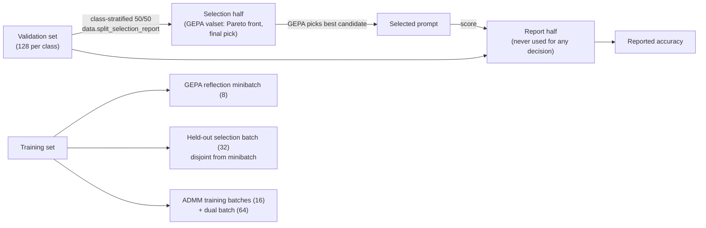
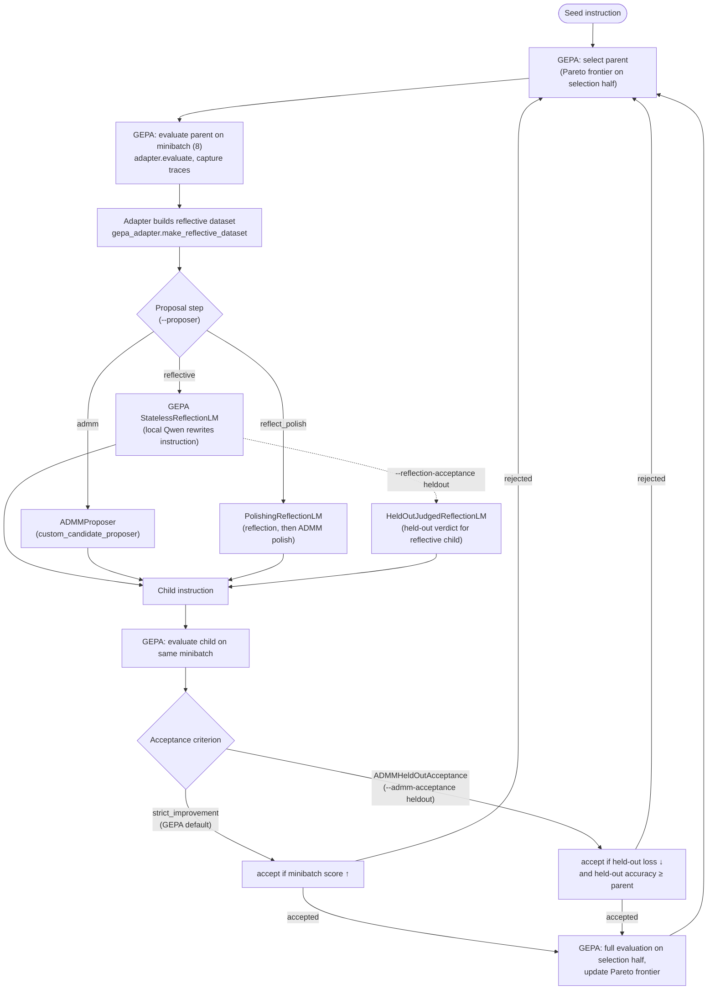
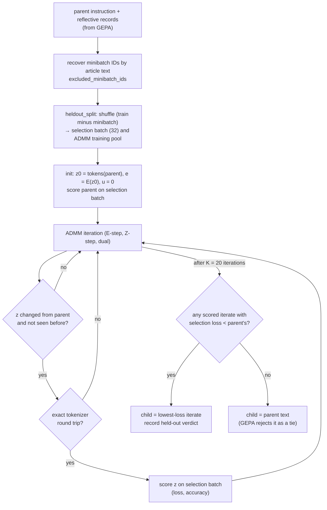
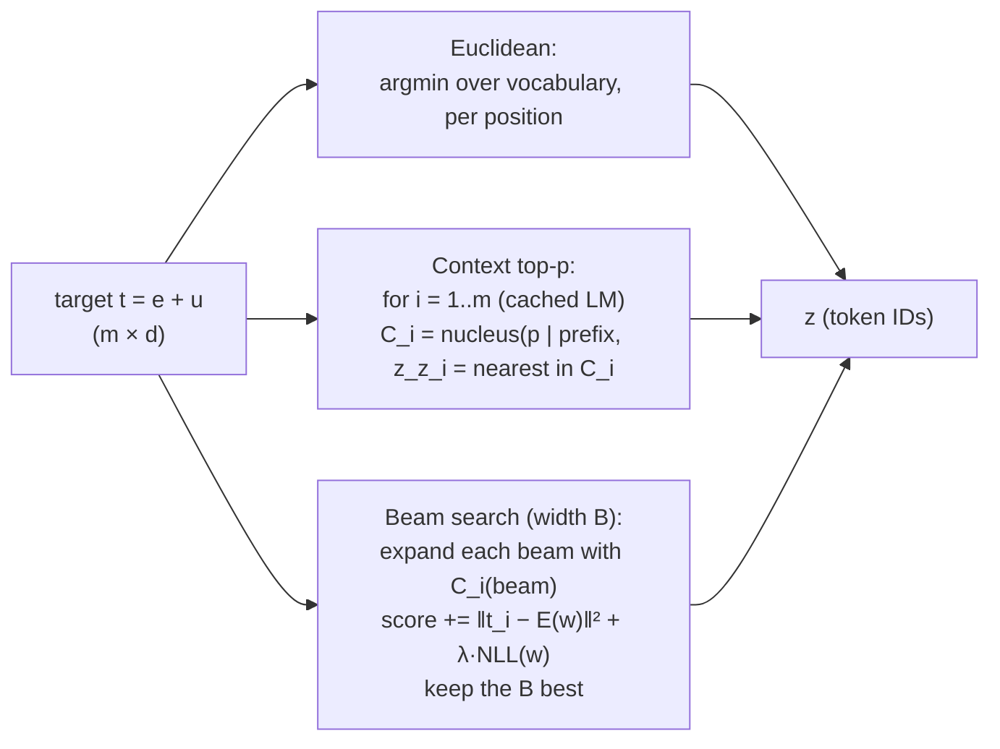
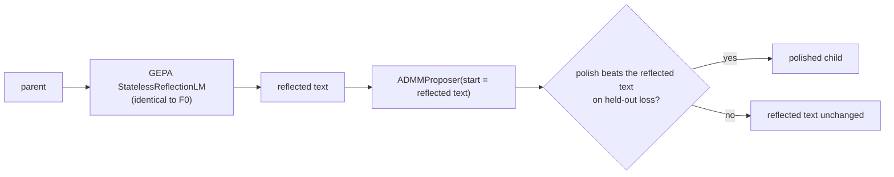
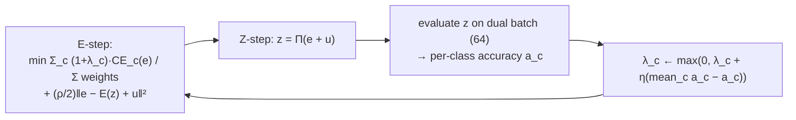

# ADMM inside GEPA: consolidated classification results

This document collects every classification experiment run after the pilot
(see [`README.md`](README.md) for the original pilot, Stages 0–III). The
pilot compared GEPA and ADMM as *separate* optimizers. Everything here runs
ADMM **inside** GEPA, as a candidate proposer, on the real GEPA library.

All numbers are regenerated from the saved runs by
[`src/gepa_pilot/summarize_classification.py`](src/gepa_pilot/summarize_classification.py),
which writes
[`artifacts/classification_results/summary.json`](artifacts/classification_results/summary.json).
The official test splits have **not** been used.

---

## 1. Headline

**Main finding.** The best variant is beam-search ADMM: ADMM as GEPA's
proposer, with a fluency-constrained beam-search projection and held-out
acceptance. It beats reflective GEPA on both tasks, including reflective
baselines matched for compute and for acceptance. The advantage is
consistent but modest, and borderline-significant at matched compute.

Accuracy is measured on the 256-example **report half** of validation, which
no selection step sees. Each cell is the mean ± sd over 10 seeds.

| Arm | AG News (4 classes) | Emotion (6 classes) |
|---|---:|---:|
| Seed instruction | 30.86 | 35.94 |
| Reflective GEPA (12 proposals) | 34.57 ± 2.45 | 35.73 ± 0.36 |
| Strongest matched reflective baseline (30 proposals, held-out acceptance) | 35.70 ± 1.71 | 36.20 ± 0.65 |
| ADMM proposer, top-p projection | 36.88 ± 2.23 | — |
| **ADMM proposer, beam-search projection (λ = 0.3)** | **38.32 ± 3.00** | **37.32 ± 1.69** |
| Beam ADMM + per-class reward constraints | 37.38 ± 2.37 | 37.21 ± 2.28 |

| Comparison | Difference | Welch p | Mann–Whitney p | Bootstrap 95% CI |
|---|---:|---:|---:|---|
| AG News: beam ADMM − reflective (12 proposals) | +3.75 | 0.007 | 0.009 | [+1.5, +6.1] |
| AG News: beam ADMM − matched baseline (30 proposals, held-out) | +2.62 | 0.031 | 0.034 | [+0.6, +4.7] |
| AG News: beam ADMM − reflective (40 proposals, ≈ wall-time match) | +2.73 | 0.066 | 0.021 | [+0.1, +5.3] |
| Emotion: beam ADMM − reflective (12 proposals) | +1.59 | 0.016 | 0.003 | [+0.6, +2.7] |
| Emotion: beam ADMM − matched baseline | +1.12 | 0.075 | 0.127 | [+0.1, +2.2] |

**What this does and doesn't establish**
- **Established:** a consistent advantage of +1 to +4 pp across every
  reflective configuration tried, on two tasks.
- **Not established:** a confirmed claim. About 6 ADMM variants were tried
  before settling on beam λ = 0.3, the matched-compute p-values are 0.03–0.08,
  and the locked test sets are unused.
- **Prompt quality:** the selected prompts are mostly fluent, with
  occasional slips (examples in §5.10).

---

## 2. Setup and protocol

| Component | AG News | Emotion |
|---|---|---|
| Dataset | `fancyzhx/ag_news` | `dair-ai/emotion` (`split` config) |
| Classes → letters | World, Sports, Business, Sci/Tech → A–D | Sadness, Joy, Love, Anger, Fear, Surprise → A–F |
| Config | [`configs/pilot.yaml`](configs/pilot.yaml) | [`configs/emotion.yaml`](configs/emotion.yaml) |
| Train / validation | 256 / 512 (64 / 128 per class) | 384 / 768 (64 / 128 per class) |
| Prepared data | [`artifacts/data/`](artifacts/data/) | [`artifacts/data_emotion/`](artifacts/data_emotion/) |

**Shared by both tasks**
- **Model:** frozen `Qwen/Qwen3-1.7B` (BF16, thinking disabled).
- **Scoring:** next-token logits of the label letters at the answer position.
- **Reflection model:** the same frozen Qwen, sampling with fixed per-call seeds.
- **GEPA:** the [`yutongselinaxiao/gepa-admm`](https://github.com/yutongselinaxiao/gepa-admm)
  fork at `v0.1.4`, installed in editable mode from
  [`third_party/gepa`](third_party/gepa). It is **unmodified**: every ADMM
  component plugs in through GEPA's public API.
- **Budget per run:** 12 proposals (unless stated), reflection minibatch of 8,
  Pareto candidate selection, merge disabled.
- **Hardware:** physical GPUs 4–7, with one job queue per GPU.

### Evaluation protocol (from Phase 2 on)



- **Report-half accuracy is the primary metric.** A
  [re-scoring of earlier runs](#56-e6--the-validation-split-and-best-of-k-bias)
  showed that selecting and scoring on the same data inflated arms that
  evaluate more candidates by about 1 pp.
- **Seeds:** `--run-seed` offsets the GEPA, reflection and ADMM seeds; the data
  split is fixed. Arms are compared as **independent** samples (Welch t-test,
  Mann–Whitney, bootstrap), not paired, because same-seed runs do not follow
  the same trajectory across arms (§6).
- **Identical starting point, verified:** all 141 runs start from the same seed
  instruction per task, the first proposal's parent is always that seed, and
  the seed's report-half score is identical in every run. AG News is 101 runs
  (30.86%), emotion 40 runs (35.94%).

---

## 3. System architecture

ADMM is added to GEPA without modifying the library, through three public
hooks: `custom_candidate_proposer`, `reflection_strategy` and
`acceptance_criterion`.



**Where each piece lives**

| Component | File | Key symbols |
|---|---|---|
| CLI and arm wiring (proposer, acceptance, split, reflection template) | [`run_gepa.py`](src/gepa_pilot/run_gepa.py) | `main`, `reflection_prompt_template` |
| GEPA adapter (scoring and reflective records) | [`gepa_adapter.py`](src/gepa_pilot/gepa_adapter.py) | `AGNewsGEPAAdapter.evaluate`, `make_reflective_dataset` |
| Shared evaluator (text and soft-slot scoring) | [`evaluator.py`](src/gepa_pilot/evaluator.py) | `CommonEvaluator.evaluate`, `score_slot_embeddings`, `score_fixed_slot_ids` |
| Prompt with one editable slot | [`prompting.py`](src/gepa_pilot/prompting.py) | `PromptBuilder.encode` (prefix, slot and suffix token IDs) |
| ADMM core | [`admm.py`](src/gepa_pilot/admm.py) | `ADMMHyperparameters`, `ADMMState`, `ADMMRefiner` |
| ADMM inside GEPA | [`admm_proposer.py`](src/gepa_pilot/admm_proposer.py) | `ADMMProposer`, `ADMMHeldOutAcceptance`, `PolishingReflectionLM`, `HeldOutJudgedReflectionLM`, `heldout_split` |
| Local reflection model | [`local_reflection.py`](src/gepa_pilot/local_reflection.py) | `LocalQwenReflectionLM` |
| Task configuration | [`config.py`](src/gepa_pilot/config.py) | `TaskConfig` (defaults reproduce AG News exactly) |
| Validation split | [`data.py`](src/gepa_pilot/data.py) | `split_selection_report` |

---

## 4. Formulations tested

Notation:
- *s* is the instruction slot, with *m* tokens.
- *E(z)* is the input-embedding matrix rows of token IDs *z*.
- *e* is the continuous slot (an *m × d* matrix).
- *u* is the scaled dual variable, and ρ is the ADMM penalty.
- *F_B(e)* is the mean label cross-entropy on batch *B* when the slot holds *e*.

### 4.1 F0 — reflective GEPA (baseline)

GEPA's own loop with the local reflection model. Variants: more proposals
(30 or 40), and/or held-out acceptance (§4.6).

```text
P ← {seed}                                  # candidate pool, scored on the selection half
repeat for N proposals:
    parent ← pareto_select(P)
    B ← next_minibatch(train, 8)
    traces ← evaluate(parent, B)             # per-example correctness, label scores, feedback
    child ← reflection_LM(template(parent, traces))   # rewrite, at most 90 words
    if accept(parent, child, B):              # default: sum correct(child,B) > sum correct(parent,B)
        P ← P ∪ {child}; score child on the selection half
return argmax_{p ∈ P} accuracy(p, selection half)
```

- **Files:** GEPA itself (`third_party/gepa/src/gepa/core/engine.py`),
  [`run_gepa.py`](src/gepa_pilot/run_gepa.py) (`--proposer reflective`),
  [`gepa_adapter.py`](src/gepa_pilot/gepa_adapter.py),
  [`local_reflection.py`](src/gepa_pilot/local_reflection.py).
- **Template:** `reflection_prompt_template`, generated from the task config.
  It is byte-identical to the pilot's for AG News.

### 4.2 F1 — standalone ADMM (pilot, Stage III)

Fixed-length slot, scaled-form ADMM, always starting from the seed.

```text
z ← tokens(seed); e ← E(z); u ← 0
for k = 1..K:
    B_k ← next_batch(train, 16)
    repeat 3 times:                              # E-step: Adam on the augmented loss
        e ← e − lr · ∇_e [ F_{B_k}(e) + (ρ/2)‖e − E(z) + u‖² ]
    z ← Π(e + u)                                 # Z-step: projection onto tokens (§4.4)
    u ← u + e − E(z)                             # dual update
    every 5 iterations: decode z, check exact round trip, evaluate on validation
```

- **Files:** [`run_admm.py`](src/gepa_pilot/run_admm.py) (driver),
  [`admm.py`](src/gepa_pilot/admm.py): `ADMMRefiner.init_state`, `ADMMRefiner.step`.
- **Refactor check:** in deterministic mode, the refactored loop reproduces
  the original code exactly (§5.2).

### 4.3 F2 — ADMM as GEPA's proposer

GEPA selects the parent; ADMM turns it into a child. The slot length equals
the parent's own token length, so ADMM can refine any GEPA candidate.



```text
function ADMMProposer(parent, reflective_records):
    excluded ← training IDs of GEPA's minibatch (matched via article text)
    S, T ← heldout_split(train \ excluded, |S| = 32, seed + call_index)
    z0 ← slot_tokens(parent); state ← init(z0)
    L0, A0 ← loss_and_accuracy(z0, S)
    scored ← {}
    for k = 1..K:
        ADMM step on batches drawn from T (with Π from §4.4)
        if z ≠ z0 and z ∉ scored and round_trip_exact(z):
            scored[z] ← loss_and_accuracy(z, S)
    improving ← {z ∈ scored : loss(z) < L0}
    if improving is empty: return parent                    # outcome logged
    z* ← argmin_{z ∈ improving} loss(z)
    heldout_decisions[text(z*)] ← (accuracy(z*) ≥ A0)        # read by §4.6
    return text(z*)
```

- **Files:** [`admm_proposer.py`](src/gepa_pilot/admm_proposer.py)
  (`ADMMProposer.__call__`, `heldout_split`, `excluded_minibatch_ids`), wired
  through `custom_candidate_proposer` in [`run_gepa.py`](src/gepa_pilot/run_gepa.py)
  (`--proposer admm`).
- **Logs:** each proposal goes to `admm_proposals.jsonl` in the run directory:
  per-iteration residuals, scored iterates and the outcome.
- **Settings used:** K = 20, ρ ∈ {0.1, 0.3, 1}, 3 Adam E-steps at lr = 0.005,
  training batch 16, selection batch 32.

### 4.4 Z-step projections Π

Three projections were tested. Every candidate set is restricted to the
**allowed vocabulary**: all non-added tokens, with control tokens such as
`<tool_call>` excluded (§5.4).

| Projection | Candidates at position *i* | Choice | Flag |
|---|---|---|---|
| Euclidean (pilot) | entire allowed vocabulary | nearest embedding to (e+u)_i, independently per position | `--admm-projection euclidean` |
| Context top-p | nucleus (top_p) of the LM's next-token distribution given the prompt prefix and z_<i, plus the parent's token z0_i | nearest embedding within that set, left to right | `context_top_p` |
| Beam search | same set per beam | beam search over the whole slot, minimizing Σᵢ ‖(e+u)ᵢ − E(wᵢ)‖² + λ·NLL(wᵢ \| prefix, w_<i) | `context_beam` |



```text
function beam_projection(t, prefix, z0, B, λ, p):
    beams ← [(score = 0, tokens = [])]; cache ← LM(prefix)
    for i = 1..m:
        candidates ← []
        for each beam b:
            C ← nucleus_p(LM_next(b)) ∩ allowed ∪ {z0_i}
            for w in C:
                candidates.add(b, w, b.score + ‖t_i − E(w)‖² + λ · (−log p(w | b)))
        beams ← B lowest-score candidates; reorder KV cache; advance LM by one token
    return tokens of the lowest-score beam
```

- **Files:** [`admm.py`](src/gepa_pilot/admm.py): `nearest_embedding_token_ids`,
  `ADMMRefiner._candidates`, `_project_context_top_p`, `_project_context_beam`,
  and `build_allowed_token_ids` for the vocabulary filter.
- **Correctness check:** beam search with B = 1 and λ = 0 reproduces greedy
  top-p on a real 20-iteration trajectory, matching at every iteration
  including 5 with token changes.
- **Settings used:** p = 0.99, B = 4, λ ∈ {0.3, 1.0}, ρ = 0.1.

### 4.5 F3 — reflect-then-polish

The reflection model rewrites the instruction exactly as in F0. ADMM, using
the context top-p projection, then polishes the rewrite, keeping it only if a
polished version beats it on the held-out batch.



- **Files:** [`admm_proposer.py`](src/gepa_pilot/admm_proposer.py):
  `PolishingReflectionLM`, passed as GEPA's `reflection_strategy`
  (`--proposer reflect_polish`).
- **Check:** the reflection output is identical to the reflective arm's; the
  first raw reflection output matches word for word.

### 4.6 Acceptance rules

```text
minibatch (GEPA default):  accept ⇔ Σ correct(child, B) > Σ correct(parent, B),  |B| = 8
held-out:                  accept ⇔ loss(child, S) < loss(parent, S)
                                    and accuracy(child, S) ≥ accuracy(parent, S),  |S| = 32,
                                    S disjoint from B and from ADMM's training batches
```

- **Files:** [`admm_proposer.py`](src/gepa_pilot/admm_proposer.py):
  `ADMMHeldOutAcceptance` (`--admm-acceptance heldout`). For reflective
  children, `HeldOutJudgedReflectionLM` (`--reflection-acceptance heldout`)
  computes the same verdict on the same kind of batch.

### 4.7 F4 — reward-constrained ADMM (per-class dual weights)

One multiplier λ_c per class, updated from the *discrete* prompt's per-class
accuracy. The reward enters only through function values, never gradients.



```text
D ← first 64 examples of ADMM's training pool       # disjoint from minibatch and selection batch
λ ← 0  (one per class)
for k = 1..K:
    E-step with class weights w_y = 1 + λ_y         # plain mean CE when λ = 0
    Z-step and dual update as in F1
    a_c ← accuracy of z on D, per class (cached per distinct z)
    λ_c ← max(0, λ_c + η · (mean(a) − a_c))         # projected online gradient ascent
```

- **Files:** [`admm.py`](src/gepa_pilot/admm.py): `ADMMRefiner.step(class_weights=…)`,
  `per_class_accuracy`; [`admm_proposer.py`](src/gepa_pilot/admm_proposer.py):
  the dual block in `ADMMProposer.__call__`. Flags: `--admm-dual-step 1.0`,
  `--admm-dual-batch-size 64`.

---

## 5. Experiments

Each entry lists its purpose, setup, result, what it shows, and where the
artifacts are. Numbers are report-half accuracy unless stated.

### 5.1 E0 — parity: the GEPA fork reproduces the pilot
- **Purpose:** make sure that switching from the pip-installed GEPA to an
  editable fork changes nothing.
- **Setup:** rerun the pilot's best GEPA configuration (minibatch 8, 12
  proposals) on the fork and compare 4 tiers of outputs.
- **Result:** identical at every tier:
  - seed scores;
  - all 12 proposal texts;
  - accept/reject decisions;
  - all 81 callback events, including the raw reflection outputs;
  - 574 per-example output files (maximum label-logit difference 0.0);
  - the serialized GEPA state.
- **Rechecked after every change** that touched the GEPA path:
  `parity_phase1_mb8`, `parity_compute_mb8`, `parity_task_config_mb8`.
- **Shows:** the fork and every later change leave reflective GEPA unchanged
  when it runs in isolation.
- **Artifacts:** [`artifacts/parity_fork_mb8/README.md`](artifacts/parity_fork_mb8/README.md);
  checker [`compare_parity.py`](src/gepa_pilot/compare_parity.py).

### 5.2 E1 — ADMM refactor check and ADMM non-reproducibility
- **Purpose:** check that moving the ADMM loop into `ADMMRefiner` changed
  nothing.
- **Setup:** rerun standalone ADMM at ρ = 1 with the original code and with
  the refactored code, in default mode and in PyTorch deterministic mode.
- **Result, default mode:** three runs of the *same* command agree bit for bit
  through iteration 10, then diverge. Best validation accuracy:
  - 32.62% (pilot);
  - 35.74% (original code, rerun);
  - 31.25% (refactored code).
- **Result, deterministic mode** (`torch.use_deterministic_algorithms`):
  original and refactored code are identical, even on different GPUs. All
  numbers shift, though; the seed scores 30.08% instead of 30.47%.
- **Shows:**
  - The refactor is correct.
  - ADMM in default mode is not reproducible: GPU rounding noise in the
    backward pass is amplified by the nearest-token projection.
  - So the pilot's single ADMM number was one sample from a wide spread, and
    every later comparison uses multiple seeds.
- **Artifacts:** `artifacts/det_{original,refactor}_admm_rho1`,
  `artifacts/repeat_original_admm_rho1`, `artifacts/parity_refactor_admm_rho1`.

### 5.3 E2 — Phase 1: Euclidean ADMM proposer with GEPA's minibatch acceptance
- **Setup:** F2 with Euclidean projection, ρ ∈ {0.3, 1}, 20 iterations,
  3 seeds, minibatch acceptance. Selection was on the full 512 validation
  examples; the numbers below are re-scored on the report half.
- **Result:**

  | Arm | Report-half accuracy | Accepted proposals per run |
  |---|---:|---:|
  | Reflective | 36.07 ± 3.63 | 3.3 |
  | ADMM ρ = 0.3 | 32.55 ± 3.54 | 1.3 |
  | ADMM ρ = 1 | 32.55 ± 2.35 | 1.7 |

  **19 rejected ρ = 0.3 children beat their parent on validation**, including
  one at 41.0% full-validation accuracy (` capital` → `资本`).
- **What ADMM changed:** 1–3 tokens per child, almost all garbage: CJK
  characters, code identifiers, emoji, and one explicit sexual token
  (` analsex`).
- **Shows:**
  - ADMM produces useful candidates, but GEPA's 8-example rule can't detect a
    1–3 token improvement, so they are rejected as ties.
  - Unconstrained projection produces unreadable prompts.
- **Artifacts:** [`artifacts/phase1/`](artifacts/phase1/),
  [`scripts/run_phase1_main.sh`](scripts/run_phase1_main.sh).

### 5.4 E3 — projection diagnostics
- **Purpose:** explain the garbage tokens, and test whether a different
  projection distance would help.
- **Result:**
  - **The continuous gain is lost at projection.** The continuous loss reaches
    about 2 nats, but the projected prompt usually stays at the seed's 8.75
    (median gap about 6.4 nats). The Lipschitz bound L·‖e − E(z)‖ is
    654–10,996 nats, 100–1000× the actual gap, so it says nothing useful.
  - **Projection is "sticky", but not where the garbage comes from.** Tokens
    are far apart: nearest-neighbor distance 1.37 against a token norm of
    1.58. Random moves of radius 5 never change a token; at radius 10–15 the
    replacements are sensible variants (`output` → ` Output`, `输出`).
  - **The garbage comes from the gradient.** ADMM's edits favor low-norm,
    rarely trained "glitch" tokens: median norm percentile 19.7, against
    27–56 for random-displacement replacements.
  - **Other distances don't help:** cosine, whitened and all-but-the-top
    projections were no better, and some were worse.
  - **Bug found and fixed:** 6 Qwen control tokens (`<tool_call>`, `<think>`,
    …) are registered with `special=False` and leaked into the allowed
    vocabulary. No reported prompt used them.
- **Shows:** to get sensible tokens, constrain where the iterate is allowed to
  go, not how distance is measured.
- **Artifacts:** [`artifacts/projection_diagnostics/README.md`](artifacts/projection_diagnostics/README.md),
  [`projection_diagnostics.py`](src/gepa_pilot/projection_diagnostics.py).

### 5.5 E4 — held-out acceptance (Phase 1b)
- **Setup:** E2 with `--admm-acceptance heldout`, 3 seeds.
- **Result:**
  - Accepted proposals per run rise from 1–3 to 7–11.
  - Accuracy scored on the same full validation set used for selection looks
    competitive: 36.33 (ρ = 0.3) and 34.96 (ρ = 1).
  - The **unbiased report-half** numbers are lower: 35.42 ± 4.56 and
    34.11 ± 1.37.
- **Shows:** acceptance was the bottleneck; but with selection and scoring on
  the same data, these numbers are inflated (see E6).
- **Artifacts:** [`artifacts/phase1_heldout/`](artifacts/phase1_heldout/),
  [`scripts/run_phase1_heldout.sh`](scripts/run_phase1_heldout.sh).

### 5.6 E5 — fluency vs. helpfulness of ADMM's edits
- **Setup:** score each of the 97 proposed Euclidean edits by the LM's
  negative log-likelihood (NLL) in context, and compare with its change in
  validation accuracy.
- **Result:**
  - The median NLL of an inserted token is 21.9 nats, against 10.5 for the
    token it replaced.
  - **Helpful and unhelpful edits are equally disfluent** (median NLL 21.9 vs.
    21.3).
  - A fluency filter keeping edited-token NLL ≤ 12 keeps only 3 of 66 helpful
    edits, with a best gain of +2.0 pp.
  - Every large gain was a glitch token.
- **Shows:** a perplexity filter applied *after* the search would remove
  almost all of Euclidean ADMM's gains. Fluency has to shape the search
  itself, which motivated the top-p and beam projections.
- **Note:** this was a one-off analysis script, not committed; the numbers are
  from the logs in `artifacts/phase1*`.

### <a name="56-e6--the-validation-split-and-best-of-k-bias"></a>5.7 E6 — the validation split and best-of-k bias
- **Problem:** GEPA selected *and* we scored on the same 512 examples. Picking
  the best of k noisy scores inflates the winner, and arms that evaluate more
  candidates get more inflation.
- **Fix:** a class-stratified 256/256 split (`data.split_selection_report`).
  Every earlier run was re-selected on the selection half and scored on the
  report half ([`rescore_split.py`](src/gepa_pilot/rescore_split.py)).
- **Result:**
  - Held-out ADMM arms, which evaluate 10–12 candidates, lose about 0.9 pp.
  - Reflective, which evaluates 3–5, gains 1.0 pp.
  - The apparent ADMM advantage over reflective flips sign.
- **Shows:** all later comparisons must use the report half
  (`--selection-split`).
- **Artifacts:** [`artifacts/split_rescore/rescore.json`](artifacts/split_rescore/rescore.json).

### 5.8 E7 — Phase 2: fluent projections and reflect-then-polish
- **Setup:** all with `--selection-split`:
  - reflective (10 seeds);
  - reflect-then-polish (F3; top-p projection, ρ = 0.1, p = 0.99; 3 seeds);
  - ADMM alone with top-p projection and held-out acceptance (10 seeds).
- **Calibration first:** top-p projection at ρ = 0.3 never moved a token. At
  ρ = 0.1, p = 0.99 it produced English edits ("choose", "state only",
  "category capital letter").
- **Result:**

  | Arm | Accuracy | Note |
  |---|---:|---|
  | Reflective | 34.57 ± 2.45 | |
  | Reflect-then-polish | 34.77 ± 1.35 | wall time 437 s |
  | Top-p ADMM | **36.88 ± 2.23** | vs. reflective +2.30, p = 0.042, CI [+0.4, +4.3] |

  - **The polish made reflections worse:** it raised the slot's NLL by a median
    of 23 nats ("the article's" → "a blog's", "focusing" → "removing"), and
    GEPA still accepted 8 polished children.
- **Shows:**
  - Fluency constraints remove the garbage without losing ADMM's advantage.
  - Polishing already-fluent text only degrades it.
- **Artifacts:** [`artifacts/phase2/`](artifacts/phase2/),
  [`scripts/run_phase2_polish.sh`](scripts/run_phase2_polish.sh),
  [`scripts/run_phase2_more_seeds.sh`](scripts/run_phase2_more_seeds.sh).

### 5.9 E8 — beam-search projection
- **Setup:** F2 with the beam-search projection (B = 4), λ ∈ {0.3, 1.0},
  3 seeds; then λ = 0.3 extended to 10 seeds.
- **Calibration:**
  - **λ = 0.3:** local phrase edits ("output the integer corresponding to
    letter").
  - **λ ≥ 1:** the LM's own text takes over ("Please classify … into:
    Politics, Sports, Technology …"), inventing labels that contradict the
    mapping, and the fixed slot length truncates sentences.
- **Result:**
  - λ = 0.3 (10 seeds): **38.32 ± 3.00**. All 10 seeds beat the seed
    instruction, and the best seed reached 44.53%.
  - λ = 1.0 (3 seeds): 35.42 ± 7.76, unstable; one run fell to 26.95%, below
    the seed.
  - Beam vs. top-p: +1.45, p = 0.24, not significant.
- **Example selected prompts:**
  - "Carefully determine a subject for news topic from the text provided, and
    classify it, and output only the corresponding topic letter." (44.53%)
  - "Carefully determine the article's main topic from the label mapping,
    choose one label, and output only the corresponding capital letter."
  - Slips occur: "Pleasefully determine…", "the broad's main topic".
- **Shows:** a small fluency weight in a joint (beam) projection gives the best
  accuracy and readable multi-word edits. A large weight lets the LM override
  the task.
- **Artifacts:** `artifacts/phase2/beam_*`,
  [`scripts/run_phase2_beam.sh`](scripts/run_phase2_beam.sh),
  [`scripts/run_phase2_beam_more_seeds.sh`](scripts/run_phase2_beam_more_seeds.sh).

### 5.10 E9 — Phase 3: is ADMM's advantage just more exploration or compute?
- **Budgets per run:**

  | Arm | Wall time | Accepted proposals | Backward passes |
  |---|---:|---:|---:|
  | Beam ADMM | 267 s | 9.2 | 720 |
  | Reflective (12 proposals) | 110 s | 2.5 | 0 |

- **Setup:** reflective baselines, 10 seeds each:
  - (A) 30 proposals: compute only;
  - (A′) 40 proposals: ≈ wall-time match;
  - (B) held-out acceptance, 12 proposals: acceptance only;
  - (C) held-out acceptance, 30 proposals: both.
- **Result:**

  | Reflective baseline | Accuracy | Accepted | Wall time | Beam ADMM's lead | Welch p |
  |---|---:|---:|---:|---:|---:|
  | 12 proposals | 34.57 ± 2.45 | 2.5 | 110 s | +3.75 | 0.007 |
  | (A) 30 proposals | 35.16 ± 1.24 | 6.2 | 193 s | +3.16 | 0.010 |
  | (A′) 40 proposals | 35.59 ± 3.23 | 8.4 | 225 s | +2.73 | 0.066 |
  | (B) held-out, 12 proposals | 34.96 ± 1.98 | 5.5 | 131 s | +3.36 | 0.010 |
  | (C) held-out, 30 proposals | 35.70 ± 1.71 | **12.5** | 208 s | +2.62 | 0.031 |

- **The plateau.** Replaying GEPA's own selection using only the first k
  proposals of each run (10 seeds):

  | k | 6 | 12 | 18 | 24 | 30 | 40 |
  |---|---:|---:|---:|---:|---:|---:|
  | Reflective, minibatch acceptance (40-proposal runs) | 33.32 | 34.30 | 35.04 | 35.12 | 35.74 | 35.59 |
  | Reflective, held-out acceptance (30-proposal runs) | 33.79 | 34.38 | 34.88 | 35.66 | 35.70 | — |

- **Shows:**
  - Exploration explains about 1 pp of the 3.75 pp gap. With *more* accepted
    candidates than ADMM (12.5 vs. 9.2), reflection still trails by 2.6 pp.
  - Reflection plateaus around 35–36% because its proposals are paraphrases of
    one instruction (20–23 distinct texts out of 30); paraphrasing doesn't
    move the model's predictions.
  - Seed 9 of the 40-proposal arm reached 43.8%. Reflection occasionally finds
    a large win, which widens its interval.
- **Artifacts:** [`artifacts/phase3/`](artifacts/phase3/),
  [`scripts/run_phase3_compute_matched.sh`](scripts/run_phase3_compute_matched.sh),
  [`scripts/run_phase3_p40.sh`](scripts/run_phase3_p40.sh).

### 5.11 E10 — Phase 4: second task (emotion)
- **Purpose:** test whether the result is specific to AG News.
- **Setup:** the pipeline generalized through `TaskConfig`, with AG News
  verified bit-identical (data hashes, prompt token IDs, a parity run).
  dair-ai/emotion, same protocol, 10 seeds per arm.
- **Seed and manual baselines** (full validation): seed 35.94%, manual
  instructions 29.95–35.68%. One manual instruction predicts Surprise for
  481 of 768 inputs.
- **Result:**

  | Arm | Accuracy | Seeds that beat the seed instruction |
  |---|---:|---:|
  | Reflective | 35.73 ± 0.36 | 0/10 |
  | Matched baseline (30 proposals, held-out) | 36.20 ± 0.65 | 4/10 |
  | Beam ADMM | **37.32 ± 1.69** | 6/10 |

  - Beam ADMM vs. reflective: +1.59, p = 0.016.
  - Beam ADMM vs. matched baseline: +1.12, p = 0.075.
- **Shows:**
  - Same direction as AG News, smaller effect.
  - The instruction slot has little leverage on this task for this model: no
    method gains more than about 4 pp in any seed.
- **Artifacts:** [`artifacts/phase4_emotion/`](artifacts/phase4_emotion/),
  [`artifacts/emotion/baseline_results.json`](artifacts/emotion/baseline_results.json),
  [`scripts/run_phase4_emotion.sh`](scripts/run_phase4_emotion.sh).

### 5.12 E11 — Phase 5: reward-constrained ADMM (per-class duals)
- **Setup:** beam ADMM plus F4 (η = 1, dual batch 64), 10 seeds per task.
- **Smoke test:** on AG News the multipliers for the 3 under-predicted classes
  rose from 0 to about 5 until the prompt changed. Sci/Tech accuracy on the
  dual batch went from 0 to 32%.
- **Result:**

  | Task | Beam ADMM | Beam ADMM + duals | Difference | Welch p |
  |---|---:|---:|---:|---:|
  | AG News | 38.32 | 37.38 ± 2.37 | −0.94 | 0.45 |
  | Emotion | 37.32 | 37.21 ± 2.28 | −0.10 | 0.91 |

  **The weakest classes barely moved** (full-validation per-class accuracy of
  the selected prompts):
  - AG News Business: 2.1% → 1.9%.
  - Emotion Love: 9.6% → 7.2%.
  - Emotion Fear: 15.4% → 22.4%, paid for by Sadness (53.4% → 44.6%).
- **Shows:**
  - Putting the reward into the gradient step alone doesn't help. Children are
    still selected and accepted on overall loss and accuracy.
  - The persistent failure classes seem beyond what a short instruction can
    fix for this model.
  - Cross-entropy remains the objective; this is a negative ablation.
- **Artifacts:** [`artifacts/phase5_duals/`](artifacts/phase5_duals/),
  [`scripts/run_phase5_duals.sh`](scripts/run_phase5_duals.sh).

---

## 6. Limitations

- **Test sets unused.** All results are validation report-half numbers.
  About 6 ADMM variants were tried before settling on beam λ = 0.3, so the
  matched-compute p-values (0.03–0.08) are suggestive. The planned
  confirmation is one evaluation of frozen configurations on the official test
  splits.
- **Non-determinism.**
  - ADMM in default GPU mode diverges after about 10 iterations (E1).
  - Reflective GEPA reproduces exactly in isolation (E0), but **same-seed runs
    in different arms diverged** in 12 of 20 Phase 3 reruns, at proposals
    1–11, while jobs shared GPUs. The likely cause is GPU kernel selection
    under memory contention, which changes the sampled reflection text.
  - Comparisons therefore treat seeds as independent samples.
- **Compute is close, not exact.** The 40-proposal reflective arm reaches
  225 s against ADMM's 267 s.
- **One model** (Qwen3-1.7B) and **two tasks**. The ADMM advantage looks
  tied to correcting this model's class biases, and every method leaves some
  classes near 0–10% (AG News Business, emotion Love).
- **Fixed slot length within an ADMM proposal.** Length changes come only
  from reflection or from refining parents of different lengths.
- **Prompt readability.** Beam ADMM's prompts are mostly fluent but
  occasionally ungrammatical. Readability was judged by inspection and LM
  NLL, not by human rating.

---

## 7. Reproduce

```bash
source /dataMeR2/yutong/envs/myenv/bin/activate
export PYTHONPATH="$PWD/src" HF_HUB_OFFLINE=1
pip install -e third_party/gepa --no-deps                 # GEPA fork at v0.1.4

python -m gepa_pilot.prepare_data --config configs/emotion.yaml --output-dir artifacts/data_emotion

# One run of the headline method (AG News); runs use GPUs 4-7 only
CUDA_VISIBLE_DEVICES=4 python -m gepa_pilot.run_gepa --selection-split \
  --proposals 12 --reflection-minibatch-size 8 --run-seed 0 \
  --proposer admm --admm-projection context_beam --admm-top-p 0.99 --admm-rho 0.1 \
  --admm-outer-iterations 20 --admm-beam-width 4 --admm-fluency-weight 0.3 \
  --admm-acceptance heldout --run-dir artifacts/example_beam_admm

# Full phases
./scripts/run_phase2_polish.sh            # reflective, polish, top-p ADMM (seeds 0-2)
./scripts/run_phase2_more_seeds.sh        # seeds 3-9
./scripts/run_phase2_beam.sh              # beam search, λ = 0.3 / 1.0
./scripts/run_phase2_beam_more_seeds.sh   # beam search, λ = 0.3, seeds 3-9
./scripts/run_phase3_compute_matched.sh   # matched reflective baselines
./scripts/run_phase3_p40.sh               # 40-proposal reflective baseline
./scripts/run_phase4_emotion.sh           # emotion task
./scripts/run_phase5_duals.sh             # per-class reward constraints

# Tables in this document
python -m gepa_pilot.summarize_classification
python -m gepa_pilot.rescore_split        # Phase 1 re-scoring on the report half
python -m gepa_pilot.compare_parity --candidate artifacts/parity_task_config_mb8
```
