# Results log (2026-10-15 – 2026-10-16)

This log follows [`CLASSIFICATION_RESULTS.md`](CLASSIFICATION_RESULTS.md), which covers Phases 1–6.
It is organized by question. Each section gives the evidence (plots and short tables), then the
takeaway.

- **Hypothesis labels:** anything not directly measured is marked **Hypothesis**.
- **Detailed tables:** linked from each section; every number comes from the analysis scripts
  named there.

**Setup shared by all runs:**
- **Model and tasks:** Qwen3-1.7B on AG News (4 classes) and emotion (6 classes).
- **GEPA:** selection/report split of validation (256 + 256), minibatch of 8, 12 proposals per
  run unless noted.
- **Evaluation:** the prompt each run selects is scored on a 2,000-example report set (see Q5).
- **Statistics:** 10 seeds per arm, Welch's t-tests. Many comparisons are made at n = 10, so a
  single p ≈ 0.03–0.05 is suggestive, not conclusive.

---

## How to read the numbers

- **Report accuracy (%):** accuracy of the prompt a run finally selects, on the 2,000-example
  report set. Each run contributes one number.
- **Mean ± 95% CI** (bars in the figures): uncertainty about an **arm's average** over seeds.
  - It comes only from seed-to-seed variation: mean ± t(0.975, 9) × sd / √10, where sd is the
    spread of the 10 runs' report accuracies.
  - It says where the arm's true average over seeds probably lies. It is not the range of
    individual runs; the dots show those.
  - Non-overlapping bars mean two arms clearly differ. Overlapping bars can still differ, so
    use the p-values.
- **Validation net** (all per-proposal tables): for one GEPA step from a parent prompt to a
  child prompt, both are scored on the same **512 validation examples**.
  - **fixes** = examples the child gets right and the parent got wrong;
  - **breaks** = examples the parent got right and the child gets wrong;
  - **net = fixes − breaks** = the change in the number of correct answers (out of 512).
    **+5 ≈ +1 pp** of accuracy.
  - It is measured after the fact for diagnosis; GEPA and ADMM never see validation data.
- **Actually better** = net > 0.

---

## Arms

| Label | What it is | Source |
|---|---|---|
| **A** | Reflective GEPA: reflection proposes, GEPA's minibatch rule accepts | Phase 2 / 4 |
| **A′** | Reflection, accepted by the S′ judge (AG News only) | Phase 3 |
| **B** | Matched reflective: reflection, S′ judge, **30** proposals (≈ ADMM's compute) | Phase 3 / 4 |
| **C** | **Fixed-length beam ADMM proposer**, S′ acceptance — the reference arm | Phase 6 |
| **D** | Multi-length ADMM, inserted tokens = the LM's most likely token | Phase 7 |
| **E** | Reflect-then-polish: reflection drafts, beam ADMM polishes, S′ judge | Phase 7 |
| **F** | Multi-length ADMM, inserted tokens chosen by the task-loss gradient | Phase 10 |
| **G** | Gated variable-length ADMM | Phase 8 |
| **H** | C with **36** GEPA proposals (3× compute spent on more proposals) | Phase 9 |
| **I** | Multi-start: **3** ADMM runs per proposal from the same parent, pooled (3× compute) | Phase 9 |

**Terms used throughout:**
- **S:** 32 training examples that pick the best candidate inside one ADMM proposal.
- **S′:** 32 *other* training examples that decide acceptance (the "fair" rule).
- **Minibatch rule:** GEPA's default. Accept the child if it scores strictly higher than the
  parent on 8 examples.

All ADMM arms use beam projection (fluency weight λ = 0.3), 20 ADMM rounds, and selection on S.
Code for arms C–I: [`admm_proposer.py`](src/gepa_pilot/admm_proposer.py),
[`gated_admm.py`](src/gepa_pilot/gated_admm.py). Analysis:
[`phase_7_10_analysis.py`](src/gepa_pilot/phase_7_10_analysis.py) → tables in
[`tables.md`](artifacts/phase_7_10/tables.md), example proposals in
[`examples.md`](artifacts/phase_7_10/examples.md).

---

## Summary

- **Q1, parallel ADMM runs per proposal (I):** no clear benefit.
  - AG News +1.1 pp over C (p = 0.30), the same as spending that compute on 36 proposals (H,
    +1.3); emotion +0.1.
  - The extra runs do find different candidates, but mostly they turn "no change" proposals into
    real ones; the children aren't better.
- **Q2, variable length:** it depends on how tokens are inserted, and on the task.
  - Gradient-chosen insertion (F) is the best AG News arm: +3.2 pp over C (p = 0.013), +2.1 over
    equal-compute multi-start (p = 0.056).
  - LM-top-token insertion (D) doesn't help. Gated (G) is +1.6 at C's compute (p = 0.25).
  - On emotion, every insertion method falls back toward reflection.
- **Q3, reflect-then-polish works once judged fairly:** on AG News, +2.4 pp over reflection with
  the same judge (p = 0.018). The earlier "no effect" came from the acceptance rule: GEPA's
  minibatch rule rejected polished children essentially at random (20 of 26 rejections were
  exact ties). It doesn't help on emotion.
- **Q4, ADMM's best candidate is rarely from the last round,** so the proposer keeps the best
  candidate it has seen.
- **Q5, a 4×-larger evaluation set:**
  - halves the spread across seeds on emotion, where much of it was evaluation noise;
  - barely changes AG News, where runs genuinely differ;
  - removed one false positive and shifted absolute levels.
- **Q6, seeds:** at 10 seeds, the smallest difference detectable with 80% power is about 3 pp on
  AG News and about 1 pp on emotion.
  - The one open AG News question worth more seeds: does F beat equal compute? That needs about
    20 seeds per arm.
- **Q7, flips:**
  - ADMM's small edits break fewer examples than reflection's rewrites.
  - Final accuracy follows the best accepted children, not the average child, so acceptance and
    selection matter as much as proposal quality.

---

## Q1. Do parallel ADMM runs per proposal help?

### What multi-start does, and why the batch order matters
- **One ADMM refinement is deterministic** given (a) the parent prompt and (b) the sequence of
  training batches it trains on.
  - Each of the 20 rounds takes Adam steps on the task loss of a 16-example batch.
  - Which 16 examples are in the batch decides the gradient direction, so it decides where the
    continuous embeddings drift, and therefore which tokens the projection lands on.
- **So a different batch order means a different path,** and the path visits different candidate
  prompts. Starting from the same parent with the same order would give three identical copies;
  that was a real bug, caught before Phase 9.
- **Multi-start (I) runs 3 refinements** from the same parent with 3 batch orders, pools every
  candidate, and picks the best on S. H instead keeps one refinement per proposal but gives GEPA
  3× as many proposals.

```
C  (fixed-length beam ADMM):
    candidates = ADMM(parent, batch_order 0)                   # 20 rounds; every new round-trip-exact
                                                               # projected prompt is a candidate
    child = argmin_loss_on_S(candidates) if it beats the parent on S, else parent
    accept child iff loss_S′(child) < loss_S′(parent) and acc_S′(child) ≥ acc_S′(parent)

I  (multi-start, --admm-starts 3):
    candidates = ADMM(parent, order 0) ∪ ADMM(parent, order 1) ∪ ADMM(parent, order 2)
    child = argmin_loss_on_S(candidates) ...                   # then exactly as C

H  (more GEPA proposals instead):
    exactly C, but GEPA runs 36 proposals instead of 12        # same total ADMM compute as I
```

**Do the 3 starts actually find different candidates?** Yes:

| Task | Proposals | New candidates per proposal, start 0 / 1 / 2 | Winner came from start 0 / 1 / 2 | Proposals where only an extra start beat the parent |
|---|---:|---|---|---:|
| AG News | 120 | 2.6 / 2.3 / 1.9 | 41 / 35 / 37 | 20 |
| Emotion | 120 | 3.9 / 3.0 / 2.5 | 34 / 45 / 40 | 31 |

Candidates are de-duplicated across starts, so starts 1 and 2 add only prompts no earlier start
found.

**Example** (AG News, accepted, winner from an extra start; bold = inserted, strikethrough =
deleted):
- *net +44:* "…output only the category ~~capital~~ **name** letter."
- *net +10:* "…from the label ~~mapping, ignore incidental~~ **mapping and provide the** details…
  capital ~~letter.~~ **letters.**"

### Results
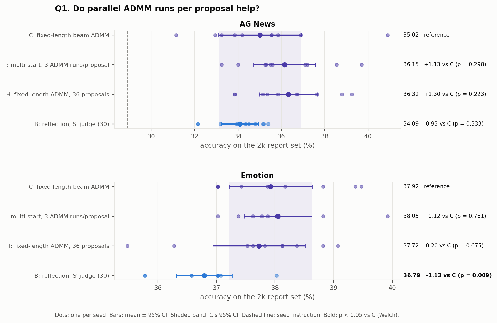

*Figure 15. Fixed-length ADMM with 1 start (C), 3 starts (I), or 36 proposals (H), plus matched
reflection (B) for reference. Report accuracy on the 2k sets.*

**Per proposal, compared fairly.** Within a run, each proposal starts from whatever parent
GEPA picked, and after the first step C, I and H follow different lineages. H's later 24
proposals also start from more optimized parents. So the fair per-proposal comparisons are:
- **The first proposal of each run:** for a given seed, all three arms start from the seed
  instruction with the same GEPA minibatch, S, S′ and training batches. They are paired by seed.
- **The first 12 proposals of each run:** the same position in the search for every arm
  (unchanged proposals count as net 0).

Net = Δ correct answers of the child vs. its parent, out of 512 validation examples.

| Task | Arm | First proposal: proposed / accepted (of 10) | First proposal: mean net | First 12 proposals: mean net |
|---|---|---:|---:|---:|
| AG News | C | 10 / 10 | +11.0 | +6.4 |
| AG News | I | 10 / 10 | +14.3 | +6.4 |
| AG News | H | 10 / 10 | +11.2 | +5.9 |
| Emotion | C | 8 / 2 | −2.4 | −1.6 |
| Emotion | I | 10 / 4 | −2.0 | −1.7 |
| Emotion | H | 8 / 2 | −2.4 | −1.6 |

- **The extra starts don't reliably give a better child.**
  - I − C on the first proposal, paired by seed: +3.3 on AG News (I better on 4 seeds, worse
    on 3, tied on 3; Wilcoxon p = 0.47), +0.4 on emotion (p = 0.84).
  - Over the first 12 proposals the arms are equal: +6.4 / +6.4 / +5.9 on AG News, about −1.6
    each on emotion.
- **Sanity check:** C and H run the same proposer with the same seed, so their first proposals
  should match, and they do on 9/10 (AG News) and 10/10 (emotion) seeds. The one difference is
  GPU nondeterminism.

*Supplementary, not controlled* (all proposals, different parents across arms):

| Task | Arm | Proposals that changed the prompt | Mean net of changed children | Accepted children (their mean net) |
|---|---|---:|---:|---:|
| AG News | C | 82% | +7.9 | 79 (+9.3) |
| AG News | I | 94% | +6.8 | 81 (+9.4) |
| AG News | H | 67% | +5.5 | 156 (+8.3) |
| Emotion | C | 81% | −2.0 | 45 (−0.8) |
| Emotion | I | 99% | −1.7 | 54 (−1.1) |
| Emotion | H | 79% | −3.4 | 140 (−2.3) |

**Why can an ADMM proposal be identical to its parent, before acceptance?**
- **GEPA's proposer hook must return a prompt text,** so an ADMM proposal that finds nothing
  useful returns the parent's own text. GEPA then sees a child identical to its parent, scores a
  tie, and rejects it.
- **Reflection almost never does this** (5 of 120 on AG News), because the LM always writes
  something new.
- **ADMM returns the parent in three cases** (counts below, out of all proposals):
  - **No token changed:** in all 20 rounds the projection mapped back to the parent's own
    tokens. The penalty ρ pulls the embeddings back toward the current tokens, and beam/top-p
    always keep the parent's token as an option (Q4), so a weak gradient never moves a token.
  - **No candidate beat the parent on S:** ADMM did produce new prompts, but none had lower loss
    on S than the parent. By design the proposer then returns the parent rather than a child it
    already expects to be worse.
  - **No exact round trip:** the new token sequence decodes to text that re-tokenizes
    differently, so it can't be submitted as a prompt.

| Task | Arm | Proposed a new prompt | No candidate beat the parent on S | No token changed | No exact round trip |
|---|---|---:|---:|---:|---:|
| AG News | C | 98 / 120 | 16 | 3 | 3 |
| AG News | I | 113 / 120 | 7 | 0 | 0 |
| AG News | H | 240 / 360 | 94 | 18 | 8 |
| Emotion | C | 97 / 120 | 22 | 0 | 1 |
| Emotion | I | 119 / 120 | 1 | 0 | 0 |
| Emotion | H | 284 / 360 | 69 | 3 | 4 |

- **Mostly the S filter:** "no candidate beat the parent" is the main reason. Multi-start nearly
  removes it, because 3 runs give 3 chances to find one.
- **H returns the parent more often** (33% on AG News vs. 18% for C).
  - **Hypothesis:** with 36 proposals, later parents are already well optimized, so ADMM finds
    fewer local improvements.

- **Final accuracy:**
  - AG News: I +1.13 (p = 0.30) and H +1.30 (p = 0.22) over C;
  - emotion: I +0.12, H −0.20; none significant.
- **What 3 starts change:** nearly every proposal now finds a candidate that beats the parent on
  S (94–99% vs. 81–82%), but in the fair comparison the children aren't better.
- **H gets its gain differently:** about twice as many accepted children (156 vs. 79). Its lower
  per-child net in the supplementary table reflects harder, later parents, not a weaker
  proposer: over the first 12 proposals it matches C.
- **Hypothesis:** the gains for I and H, where present, come from more accepted steps stacking
  along a lineage, not from better individual edits.
- **Hypothesis (overfitting to S):** picking the best of more candidates on the same 32 examples
  favors lucky candidates.
  - Weak support: in C's proposals, a larger candidate pool goes with a slightly worse chosen
    child on AG News (Spearman ρ = −0.14, p = 0.049; mean net +9.6 vs. +7.4).
  - Not seen on emotion (ρ = +0.04).
  - Correlational only.
- **Takeaway:** parallel ADMM runs aren't worth 3× compute on their own. They're the fair
  control for multi-length (Q2), which also pools 3 refinements.

---

## Q2. Comparing variable-length approaches

### What each approach does, in words
C's ADMM can only replace tokens; the prompt keeps the parent's token length. The three
variable-length arms differ in **how** the length changes and **who chooses the inserted
words**.

- **D, multi-length with LM insertion:** at the start of each proposal, make two extra versions
  of the parent and refine all three with ADMM.
  - **Shorter version:** delete the 2 tokens the task loss is least sensitive to (smallest
    gradient norm).
  - **Longer version:** at the 2 most sensitive positions, insert the word the language model
    finds most likely next.
  - The insertion ignores the task. The LM's top guess is often a repeat of a nearby word:
    "label capital **label** letter", "main emotion **emotion emotion**".
- **F, multi-length with gradient insertion:** same structure as D, but the inserted words are
  chosen for the task.
  - At each of the 6 most sensitive gaps, take the LM's 64 most likely words (to stay fluent).
  - Rank them by how much the task loss would drop (a first-order estimate from the gradient
    with respect to the inserted slot's embedding).
  - Try the best 8 per gap for real, and keep the (gap, word) with the lowest training loss.
    Repeat for the second insertion.
- **G, gated variable length:** length is decided *inside* every ADMM round, not once at the
  start.
  - Every token slot gets an on/off dial (a keep-gate between 0 and 1) that is optimized together
    with the embeddings. At 0 the token is exactly deleted.
  - 4 spare slots, dialed almost off, sit at the most sensitive positions; turning one on
    inserts a word.
  - Each round's projection decides per slot: blank, or which token. So the length can change
    by any amount, in any round. The fluency term picks the words.

### Pseudocode
```
D  multi-length, LM insertion  (--admm-length-offsets 0 -2 2)
    saliency_i = ‖∂ task_loss / ∂ e_i‖                         # per slot token, on one training batch
    short = parent minus its 2 lowest-saliency tokens
    long  = parent plus 2 tokens, each before a high-saliency position:
                token = argmax_w P_LM(w | prefix, tokens so far)
    candidates = {short, long} ∪ ADMM(parent) ∪ ADMM(short) ∪ ADMM(long)
    child = argmin_loss_on_S(candidates)                       # then S′ acceptance, as C

F  multi-length, gradient insertion  (… --admm-insertion gradient)
    as D, except each inserted token (one at a time):
        for each of the 6 most salient gaps g:
            place the LM's top token at g; ∇ = gradient of the task loss w.r.t. that slot
            W = the LM's 64 most likely tokens at g
            keep the 8 w ∈ W with the most negative (E(w) − e_g) · ∇
        insert the (g, w) with the lowest exact training loss among all ≤ 6 × 9 trials

G  gated variable length  (--admm-gated)
    slots = parent tokens + 4 spare slots before the 4 most salient positions
    each slot i: embedding e_i, keep-gate g_i = sigmoid(a_i)
        parent slots start at g ≈ 0.98; spare slots at g ≈ 0.12
    scoring: attention logit to slot i += log g_i; positions advance by g_i
        → g = 0 is exactly deletion (checked to 1e-4 logits in float32)
    each ADMM round:
        E-step (Adam on e and a): CE(e, g) + ρ/2 Σ k_i ‖e_i − E(z_i) + u_i‖² + ρ_g/2 Σ (g_i − k_i + v_i)²
        Z-step (beam, left to right), per slot:
            blank   : cost γ·t_i²
            token w : cost [‖s_i − E(w)‖² − min_w′ ‖s_i − E(w′)‖²] + γ(1 − t_i)² + λ·NLL(w | prefix)
            (s_i = e_i + u_i, t_i = g_i + v_i, γ = 10; k_i = 1 if slot i holds a token)
        duals: u_i += e_i − E(z_i) for filled slots; v_i += g_i − k_i
    every new token sequence is a candidate → argmin on S → S′ acceptance, as C
```

### Example accepted proposals (AG News)
Bold = inserted, strikethrough = deleted; net = Δ correct answers vs. the parent, of 512. More
in [`examples.md`](artifacts/phase_7_10/examples.md).

| Arm | Net | Edit |
|---|---:|---|
| D, shorter version | +31 | …from the label ~~mapping, ignore incidental details,~~ **mapping and provide details** and output only… |
| D, longer version | −10 | …Output only the corresponding **label** capital **letter** letter. |
| F, longer version | +53 | …from the ~~label mapping,~~ **text, and** ignore incidental details, and output only the **numeric** corresponding **target** capital letter. |
| F, longer version | +12 | …output only the **JSON** numeric corresponding **of** capital letter. |
| G, length changed | +35 | Carefully determine the ~~article's~~ **most appropriate and** main topic… |
| G, length changed | +13 | Carefully **read** determine the article's main topic … the corresponding **label** capital letter. |
| G, same length | +13 | …output only the corresponding ~~capital~~ **label** letter. |

**Final prompts** (AG News, each arm's median seed on the 2k set; seed instruction: *"Carefully
determine the article's main topic from the label mapping, ignore incidental details, and output
only the corresponding capital letter."*, 28.90%):

| Arm | 2k accuracy | Final prompt |
|---|---:|---|
| C fixed length | 35.55 | Carefully determine the article's main topic from the label mapping (ignore formatting details, and output only the corresponding capital letter. |
| D LM insertion | 35.40 | Carefully determine the article's main topic from the label mapping and provide details and output only the corresponding capital letter. |
| F gradient insertion | 37.55 | Carefully extract determine the topics article's main objective character topic from the label mapping, ignoring incidental details, and output only the corresponding capital letter. |
| G gated | 35.55 | Please determine the article's main topic from the label mapping, ignore the details, and output only the corresponding label capital letter. |

### Results
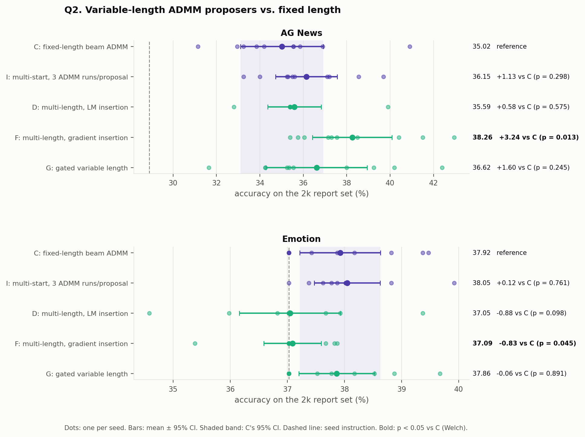

*Figure 16. C, multi-start I (same compute as D and F), and the three variable-length arms.
Report accuracy on the 2k sets.*

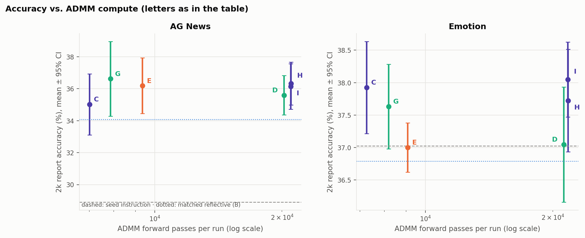

*Figure 13. Report accuracy against the ADMM compute each arm spends per GEPA run, relative to
C.*
- **Compute** = the number of model forward passes made inside the ADMM proposer over one
  12-proposal run.
  - Per proposal that's about 20 rounds × (3 E-step passes + about 26 projection steps) plus
    scoring candidates on S and S′: about 580 for C, so 1× ≈ 7,000 per run.
  - D, I and H do about 3× that work, F 3.4× (the gradient search adds trials). G does 1.1× and E
    1.3×.
- **Caveat:** forward passes are a proxy, not FLOPs; G's projection recomputes the whole prefix,
  so its passes are longer.

- **AG News:**
  - **F is the only arm significantly above C:** +3.24 pp (p = 0.013; higher than C on 8 of 10
    seeds).
  - **At equal compute,** F beats I by +2.11 (p = 0.056) and H by +1.94 (p = 0.071). D is −0.56
    vs. I, so **how the inserted words are chosen makes the difference**.
  - **G:** +1.60 (p = 0.25), at about C's compute.
- **Emotion:**
  - D (−0.88, p = 0.10) and F (−0.83, p = 0.045) fall toward the reflection level;
  - G ties C (−0.06).

### Which version wins inside D and F
Net = Δ correct answers of the chosen child vs. its parent, out of 512 validation examples.

| Arm | Task | Version | Times chosen | Accepted on S′ | Mean net | Children with net > 0 |
|---|---|---|---:|---:|---:|---:|
| D | AG News | 2 shorter | 71 | 47 | **+13.8** | 68% |
| D | AG News | same length | 27 | 12 | −5.1 | 30% |
| D | AG News | 2 longer | 16 | 7 | −4.5 | 31% |
| F | AG News | 2 shorter | 11 | 7 | +11.8 | 73% |
| F | AG News | 2 longer | **101** | 65 | **+9.2** | 74% |
| D | Emotion | 2 longer | 22 | 9 | −7.8 | 23% |
| F | Emotion | 2 longer | 88 | 47 | **−14.0** | 31% |

(All rows: [`tables.md`](artifacts/phase_7_10/tables.md).)

- **D on AG News, deletion does the work:** the recurring edit removes "ignore incidental
  details"; two seeds ended on the identical final prompt.
- **F on AG News, insertion takes over:** the longer version is chosen in 101 of 116 proposals,
  and all 10 seeds end on different prompts.
- **On emotion, the longer version hurts under both rules,** yet S′ accepts about half of these
  children.
  - **Hypothesis:** a single emotion child changes only a few answers, which is below what 32
    acceptance examples can resolve (see Q3), so harmful insertions get through.

### Proposal bench: one child per method from the same parents
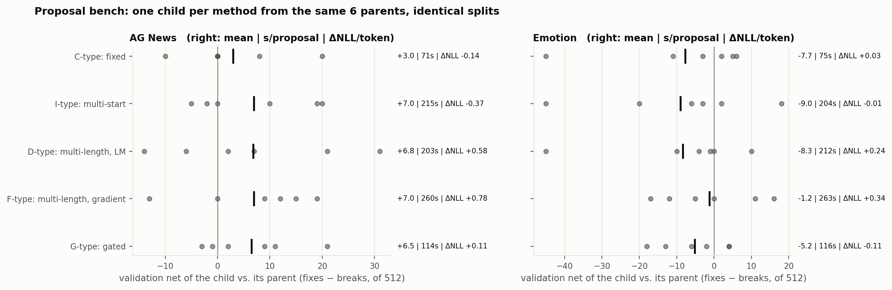

*Figure 14. Six parent prompts per task. Every method gets the same GEPA minibatch, S, S′ and
training batches; each child's net is measured on the 512 validation examples. Right of each
row: mean net | seconds per proposal | change in NLL per token (fluency; lower is better). Code:
[`length_bench.py`](src/gepa_pilot/length_bench.py).*

- **Fluency:** gated keeps it (ΔNLL +0.11 on AG News, −0.11 on emotion). Multi-length worsens
  it (+0.24 to +0.78), gradient insertion the most; see "objective character topic" in F's
  final prompt.
- **Limit:** six parents can't rank the methods; single proposals swing by ±20.

**Takeaway:**
- On AG News, gradient-chosen insertion is the most promising variable-length method, at the
  cost of fluency. Whether its edge over equal compute is real needs about 20 seeds (Q6).
- Gated is the cheapest and most fluent, with a smaller, uncertain gain.
- On emotion, variable length doesn't help with the current acceptance rule.

---

## Q3. Does reflect-then-polish work, and why didn't it earlier?

```
E  reflect-then-polish (fair)
    draft = reflection_LM(parent, minibatch mistakes)          # GEPA's normal reflective rewrite
    polished = fixed-length beam ADMM(draft) → best on S, if it beats the draft on S, else draft
    accept polished iff it beats GEPA's parent on S′           # same judge as A′ and B

old reflect-then-polish (Phase 2, 3 seeds)
    same draft and polish, but GEPA's minibatch rule decided acceptance (8 examples)
```

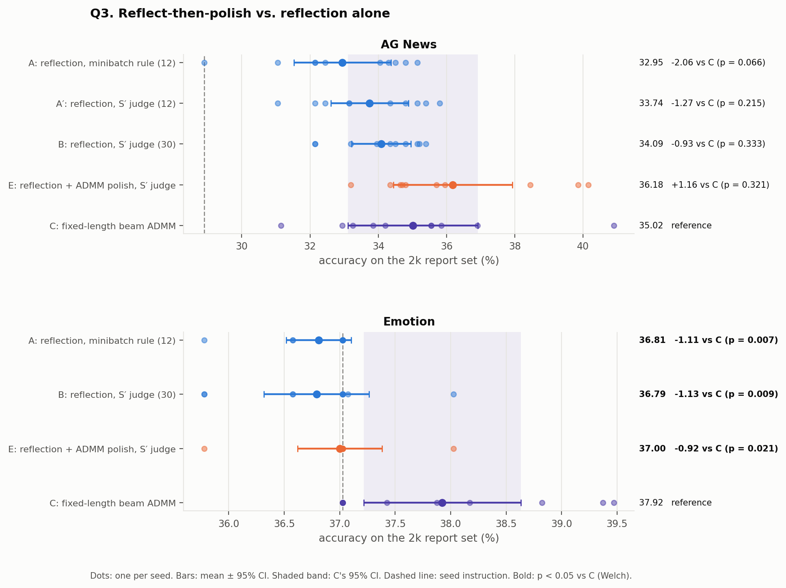

*Figure 17. Reflection with the minibatch rule (A), reflection with the S′ judge (A′ at 12
proposals, B at 30), reflect-then-polish (E), and fixed-length ADMM (C). Report accuracy on the
2k sets.*

- **On AG News, the polish works:**
  - E vs. A′ (same judge, same 12 proposals): **+2.44 pp, p = 0.018**;
  - E vs. matched reflection (B, 30 proposals): +2.09 pp, p = 0.030.
- **Not on emotion:** E is 37.00, the same as reflection, and below C (−0.92, p = 0.021).

### Why it didn't work earlier: the acceptance rule
Net = Δ correct answers of the child vs. its parent, of 512 validation examples. "Better" = net > 0.

| Task | Proposer | Rule | Accepted | % better (mean net) | Rejected | % better (mean net) | Rejections that tied |
|---|---|---|---:|---:|---:|---:|---:|
| AG News | reflect-then-polish (old) | minibatch, 8 ex. | 10 | 60% (+4.1) | 26 | **58% (+4.1)** | **20 / 26** |
| AG News | reflect-then-polish (E) | S′, 32 ex. | 63 | 68% (+10.0) | 54 | 43% (−5.6) | — |
| AG News | reflection (A) | minibatch, 8 ex. | 25 | 72% (+10.6) | 90 | 48% (+2.2) | 71 / 95 |
| AG News | reflection (A′) | S′, 32 ex. | 55 | 73% (+9.3) | 65 | 25% (−5.4) | — |
| Emotion | reflect-then-polish (E) | S′, 32 ex. | 43 | 21% (−5.7) | 77 | 29% (−5.9) | — |

- **The minibatch rule rejected polished children at random:**
  - rejected children were as good as accepted ones (58% vs. 60% better, both +4.1 on average);
  - it accepted only 10 of 36;
  - 20 of the 26 rejections were exact ties on the 8 examples.
- **Why ties:** the polish changes a median of **1 token** of the draft. On 8 examples, a
  1-token change usually leaves every answer unchanged, so parent and child tie, and a
  strict-improvement rule rejects.
- **The S′ judge separates:** 68% of accepted vs. 43% of rejected children are better (mean net
  +10.0 vs. −5.6).
- **The old comparison had only 3 seeds** (33.35 ± 0.35), too few to detect the effect anyway.
- **The polish is often a no-op:** it leaves the draft unchanged in 47% of AG News proposals.
- **Hypothesis for why E beats A′:** E's accepted children are slightly more numerous (63 vs.
  55) and slightly better (+10.0 vs. +9.3). Small, directed 1-token gains stacked over 12
  proposals could add up to the 2.4 pp difference. Not tested directly.

### Acceptance rules in general
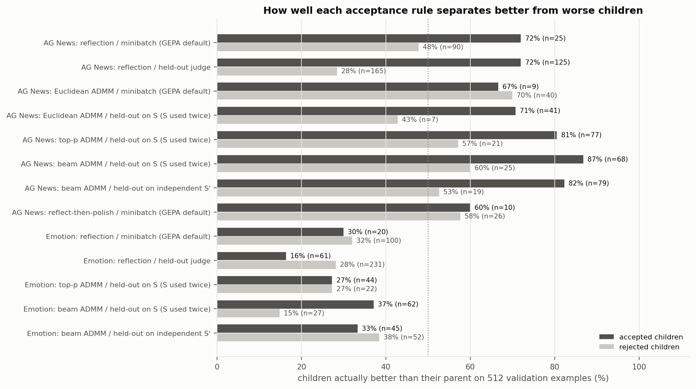

*Figure 10. Share of accepted (dark) and rejected (light) children that were actually better
(net > 0), per proposer and acceptance rule. A bigger gap means better separation.*
- **n:** the number of children that rule accepted or rejected, summed over all runs of the
  group. The label gives [runs × proposals per run].
- **Why the n's differ:**
  - **Group size:** most groups are 10 runs × 12 proposals (120). The held-out reflection groups
    are the 30-proposal runs (300); Euclidean ADMM had 6 runs (72); the old polish had 3 runs
    (36).
  - **Unchanged proposals aren't counted:** when ADMM returns the parent itself (see Q1), there
    is no child to judge. E.g. emotion top-p counts 66 of 120.
  - **The rule itself:** the minibatch rule rejects most children (AG News reflection: 25
    accepted vs. 90 rejected); the S′ judge accepts more.

- **The minibatch rule can't see small edits:**
  - Euclidean ADMM's rejected children were *more* often better (70%) than its accepted ones
    (67%);
  - it also rejected 43 reflection children that were better, mostly on ties.
- **The S′ judge separates well on AG News** (reflection: 73% vs. 25% better).
- **On emotion, no rule separates** (accepted and rejected children are 16–38% better either
  way).
  - **Hypothesis:** most emotion children change fewer answers than the measurement noise. For a
    child that flips about 13% of predictions, the net on 512 examples has noise of about
    ±1.6 pp, and more on 32.
  - This would also explain why harmful insertions pass S′ on emotion (Q2).
- **Takeaway:** acceptance is a bottleneck. It caused the earlier polish failure, and it's the
  likely limit on emotion.
- **Next steps to consider:** a larger S′ on emotion, or accepting on a confidence bound
  instead of a point estimate.

---

## Q4. ADMM: the best candidate is rarely from the last round

Each ADMM proposal runs 20 rounds, scores every new candidate on S, and returns the best. Code:
[`iterate_diagnostics.py`](src/gepa_pilot/iterate_diagnostics.py). Per-arm numbers:
`artifacts/iterate_diagnostics/summary.json`.

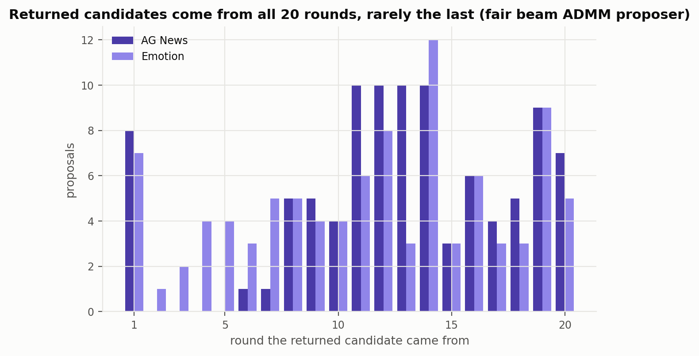

*Figure 7a. The round each returned candidate came from (C, the fixed-length beam ADMM proposer).
Median round 12–13; round 20 supplies only 7 of 98 (AG News) and 5 of 97 (emotion).*

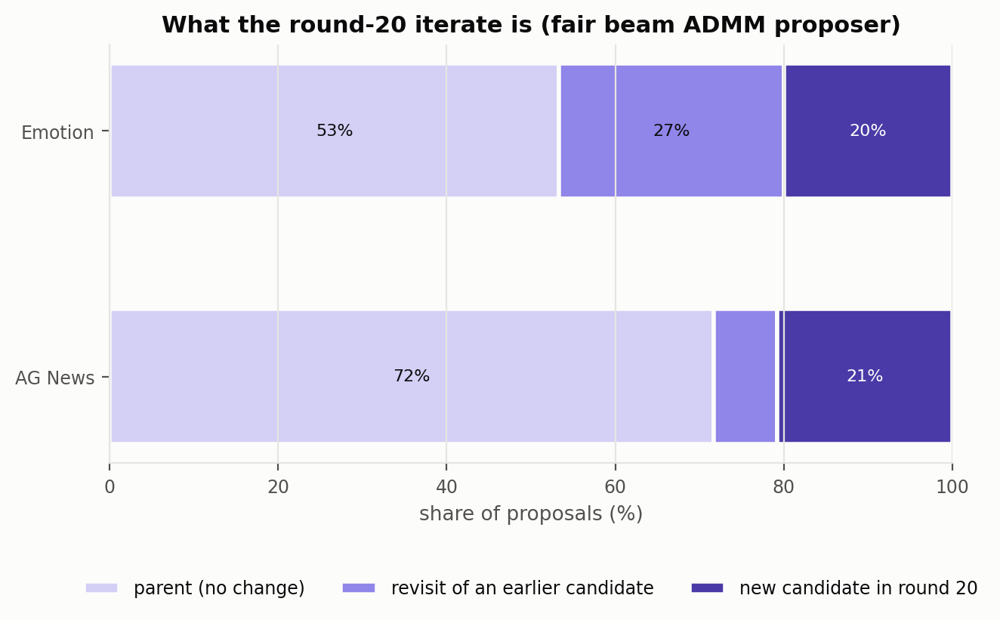

*Figure 7b. What "take the last round" would return: mostly the parent itself (72% AG News, 53%
emotion), otherwise a revisit or a worse candidate. The unlabeled AG News segment is 8%.*

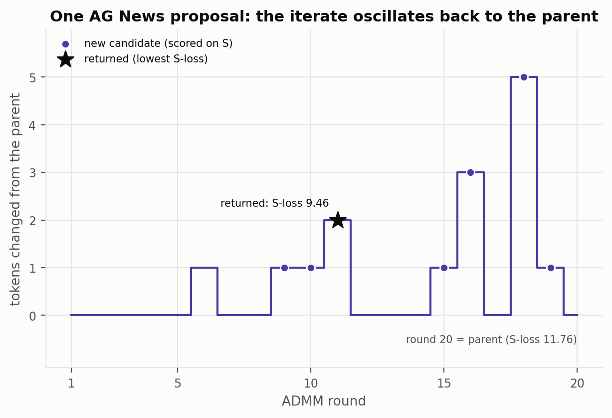

*Figure 7c. One AG News proposal from the seed instruction. It visits several 1–5 token edits
(e.g. "ignore **linguistic** details", "**Pleasefully** determine…"), returns its best at S-loss
9.46, and ends round 20 back at the parent (11.76).*

- **Oscillation, not convergence:**
  - the iterate returns to the parent 1.5–4 times per proposal;
  - in round 20 it is the parent in 53–82% of proposals.
- **The returned candidate is from round 20 in only 2–15% of proposals.**
- **The round-20 candidate is worse on S** than the returned one in 82–98% of cases (+0.25 to
  +1.0 nats).
- **Hypothesis (mechanism):**
  - the dual u builds up until the projection jumps to a new token;
  - the residual then reverses, u unwinds, and the projection jumps back;
  - top-p and beam always keep the parent's token available, which makes returning easy.
- **Implication:** keep the best candidate seen, and pool candidates across refinements (as D,
  F and I do); never take the last round.

---

## Q5. Does a larger evaluation set reduce the variance, and what else changes?

- **The 2k report sets:** class-stratified, drawn from the unused part of each official training
  split, no overlap with train or validation; the test splits stay locked.
  - AG News: 2,000 examples. Emotion: 2,004.
  - Code: [`report_set.py`](src/gepa_pilot/report_set.py).
- **The comparison:** the same runs and the same selected prompts are scored on the 256-example
  report half and on the 2k set, so any difference comes from the evaluation set alone. Code:
  [`eval_size_comparison.py`](src/gepa_pilot/eval_size_comparison.py).

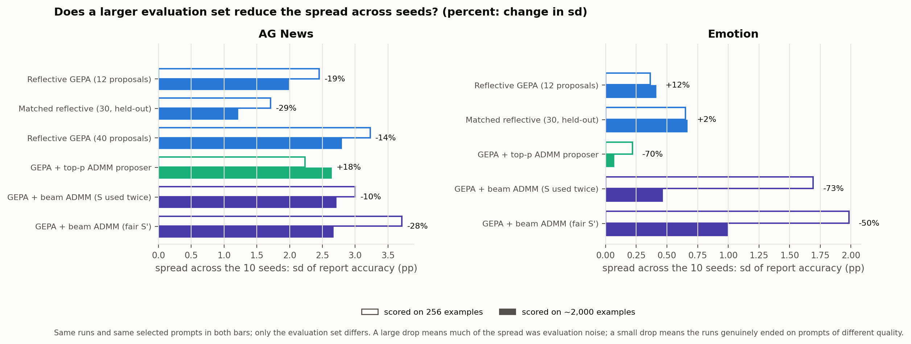

*Figure 8c. Spread across the 10 seeds (sd of report accuracy) for each arm, scored on 256
examples (outline) and ~2,000 (filled); percent = change in sd.*

- **What the spread is made of:** each run's score = the true quality of the prompt it selected
  + evaluation noise. For a single prompt at about 35% accuracy, evaluation noise has sd ≈ 3.0
  pp on 256 examples and ≈ 1.1 pp on 2,000.
- **Emotion ADMM arms: the spread drops by 50–73%** (C: 1.98 → 0.99). Much of it was evaluation
  noise; the runs' prompts are similar in true quality.
- **AG News: the spread drops only 10–29%,** and top-p even rises 18%.
  - **Hypothesis:** AG News runs genuinely end on prompts of different quality, so more seeds
    help there and more evaluation examples don't.
- **Emotion reflection arms barely change** (+2% to +12%). Most of their runs select the same
  prompt (often the seed instruction), so the spread was small to begin with.

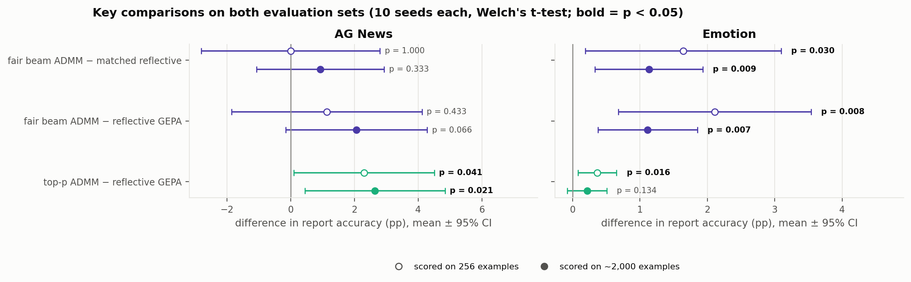

*Figure 8b. Key differences between arms (mean ± 95% CI, Welch) on each evaluation set; bold =
p < 0.05.*

- **Other effects of the larger set:**
  - **Absolute levels shift:** the 256 half was easier on AG News (seed instruction 30.9 vs.
    28.9) and harder on emotion (35.9 vs. 37.0). Compare arms, not levels.
  - **Effects can shrink while becoming more certain:** emotion C vs. B went from +1.64 to +1.13
    pp, with p improving from 0.030 to 0.009.
  - **One false positive removed:** emotion top-p vs. reflective GEPA went from p = 0.016 to
    p = 0.134.
- **Takeaway:** all results here use the 2k sets.

---

## Q6. Number of seeds: a diagnostic for whether to run more

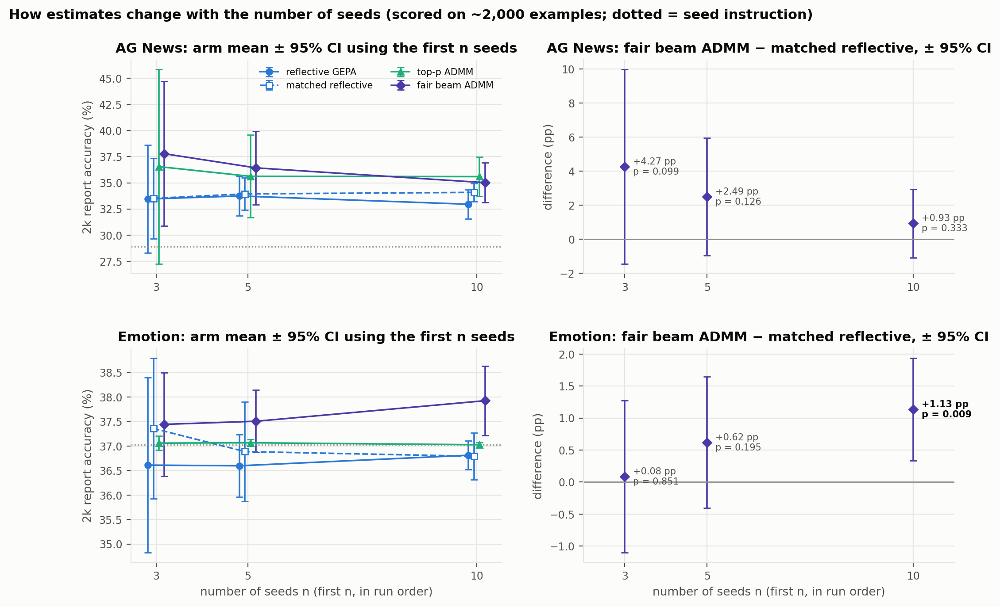

*Figure 11. Left: arm mean ± 95% CI using the first n seeds (n = 3, 5, 10). Right: C minus
matched reflection (B) as seeds accumulate. Code:
[`seed_count_analysis.py`](src/gepa_pilot/seed_count_analysis.py).*

- **3 seeds were misleading on AG News:**
  - 95% CI of ±3–9 pp;
  - C's lead over B fell from +4.3 (n = 3) to +0.9 pp (n = 10).
- **On emotion, the effect sharpened with more seeds:** +0.08 (p = 0.85) at n = 3, +1.13
  (p = 0.009) at n = 10.

**Seeds per arm needed for 80% power** (two-sided α = 0.05; normal approximation
n = 2 (1.96 + 0.84)² sd² / difference², using each pair's sd at n = 10):

| Task | Comparison | Observed difference (pp) | sd (pp) | Seeds for the observed difference | For 1 pp | For 2 pp |
|---|---|---:|---:|---:|---:|---:|
| AG News | F vs. I (equal compute) | +2.11 | 2.30 | **19** | 83 | 21 |
| AG News | F vs. H (equal compute) | +1.94 | 2.24 | **22** | 80 | 20 |
| AG News | E vs. A′ (polish effect) | +2.44 | 2.05 | 12 | 67 | 17 |
| AG News | G vs. C | +1.60 | 2.98 | 55 | 140 | 35 |
| AG News | I vs. C | +1.13 | 2.35 | 68 | 87 | 22 |
| Emotion | G vs. C | −0.06 | 0.96 | — | 15 | 4 |
| Emotion | I vs. C | +0.12 | 0.90 | — | 13 | 4 |

- **How to use it:** if a comparison's observed difference needs about 20 seeds or fewer, it's
  worth running more. If it needs 50+, the difference is too small to matter at this scale.
- **Worth more seeds:**
  - F vs. I and F vs. H on AG News: 20 seeds per arm would settle whether gradient insertion
    beats equal compute;
  - the polish effect is already at about the needed power.
- **Not worth more seeds:**
  - G vs. C and I vs. C on AG News (55–68 needed);
  - the emotion ties (the differences are about 0).

---

## Q7. Flips: what they tell us for the next step

**Definitions:**
- **Categories:** for one parent → child step, each of the 512 validation examples is a **fix**
  (wrong → right), a **break** (right → wrong), **wrong → different wrong** (e.g. World →
  Sports when the answer is Business), or unchanged.
- **Flips** = every answer that changed (all three kinds). **Net** = fixes − breaks, as defined
  above.
- **Code:** [`proposal_diagnostics.py`](src/gepa_pilot/proposal_diagnostics.py),
  [`proposal_examples.py`](src/gepa_pilot/proposal_examples.py). Worked examples:
  [`examples.md`](artifacts/proposal_diagnostics/examples.md).

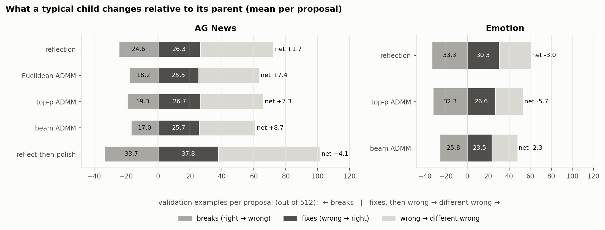

*Figure 9b. Mean fixes, breaks and wrong → different wrong per changed prompt (one experiment
per proposer, 120 proposals each). Right: net per change, net per proposer call (calls that
returned the parent unchanged count as 0), and how many of the 120 proposals changed the
prompt.*

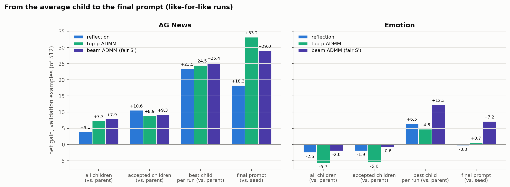

*Figure 9d. Net at each stage: all children and accepted children (vs. their parent), the best
child per run, and the final prompt (vs. the seed instruction).*

**What the flips show:**
- **Both proposers move many answers:** reflection rewrites about 40% of the text and changes
  about 17% of answers; ADMM edits 1–3 tokens and changes 12–15%.
- **The difference is direction:** on AG News, both fix about 24–27 examples per change, but
  reflection breaks more (21.8 vs. 16.3–19.3), so net +4.1 vs. +7.3 to +7.9.
- **The average child is not the outcome:** GEPA discards rejected children and builds on the
  best accepted ones.
  - On emotion every proposer's average child is negative (net −2 to −6), yet C's final prompt
    ends +7.2 answers above the seed instruction, against −0.3 for reflection.

**What this suggests for the next step:**
- **Combine reflection and ADMM.** Reflection's large rewrites move answers a lot but in no
  consistent direction; ADMM's small edits are directed.
  - This motivated reflect-then-polish, which works on AG News (Q3).
  - **Hypothesis:** small directed edits on top of big undirected rewrites is a good division of
    labor. Gradient insertion (F) is a similar "directed small edit".
- **Invest in acceptance and selection,** not only proposal quality. Outcomes follow the best
  accepted children, so a rule that reliably keeps good children and drops bad ones should pay
  off more than improving the average child.
  - Supported on AG News by Q3; on emotion this is the likely bottleneck (Q3, hypothesis).
- **Wrong → different-wrong flips** (about half of all flips) don't change accuracy, but they
  show which classes a prompt confuses.
  - **Hypothesis:** per-class targets (e.g. the class-weighted loss from Phase 5) could use
    them. Untested.

---

## Appendix: run notes and data quality

- **Out-of-memory failures on the shared GPUs** hit 4 Phase 7 runs.
  - GEPA logs a proposal's GPU error and continues, so a run can "finish" with missing proposals.
  - The queue ([`gpu_queue.py`](scripts/gpu_queue.py)) and
    [`failure_watcher.py`](scripts/failure_watcher.py) detect GPU errors in either log and rerun
    with backoff. All reruns succeeded.
- **Gated ADMM crash:** a spare slot whose nucleus held only disallowed tokens had no candidates.
  It affected 3 emotion runs. Fixed (fallback to the most likely allowed token) and rerun with
  the same seeds.
- **Multi-start bug caught before Phase 9:** extra starts initially saw the same batches
  (reshuffling only happens after a full pass through the data). Extra starts now draw their
  own order.
- **2k re-scoring:** each phase's scoring used to rebuild the run → score table, wiping earlier
  phases. No scores were lost (all are cached by prompt); the table now merges.
- **Silent-failure check:** all earlier run logs were scanned for errors GEPA had swallowed;
  none were found.
- **Incident 2026-10-15 23:48:** a `git stash -u` moved in-progress Phase 7 outputs. Affected
  runs were discarded and restarted; run directories are now git-ignored.
