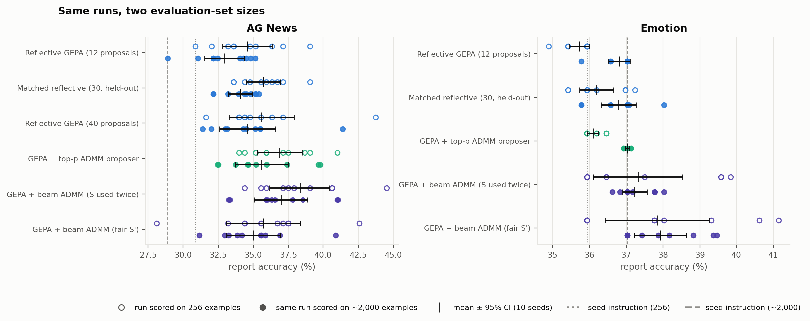

# Results log

New results after [`CLASSIFICATION_RESULTS.md`](CLASSIFICATION_RESULTS.md), whose last
update covers Phases 1–6 and the fluency analysis (2026-10-06). Entries are newest last. Each
entry says what was done, what it shows, and where the code and artifacts are.

**No new optimization seeds were added in this period.** The new numbers come from:
- a larger evaluation set (re-scoring existing runs);
- re-analysis of existing runs (seed counts, ADMM iterates, timing).

Phase 7, the first new runs, is still in progress.

Naming: "GEPA + … ADMM proposer" means ADMM replaces GEPA's reflection step; "standalone
ADMM" is the pilot only. "Fair S′" means children are accepted on an independent held-out
batch (Phase 6); "S used twice" is the earlier version that accepted on the batch that also
chose the candidate.

---

## 2026-10-15

### Larger report sets (2,000 examples per task)
- **Why:** the 256-example report half has a standard error of about 3 pp per run at
  ~35% accuracy, comparable to the whole seed-to-seed spread.
- **What:** a class-stratified report set per task, drawn from the **unused** part of each
  official training split. It never overlaps the train or validation subsets, and the official
  test splits stay locked.
  - AG News: 2,000 examples (500 per class).
  - Emotion: 2,004 examples (334 per class).
- **Code:** [`report_set.py`](src/gepa_pilot/report_set.py) (`prepare`). **Data:**
  `artifacts/data/report.json`, `artifacts/data_emotion/report.json`, each with a manifest.

### Re-scoring of every existing run on the 2,000-example sets (Stage 0)
- **What:** the prompt every finished run selected (on the 256-example selection half; selection
  unchanged) was scored on the large report set. That's 111 AG News runs (78 distinct prompts)
  and the emotion runs, plus the seed instruction.
- **Code:** `report_set.py rescore`. **Results:**
  [`artifacts/report2k/`](artifacts/report2k/).
- **Main numbers** (10 seeds):

  | Arm | AG News, 2k examples | Emotion, 2k examples |
  |---|---:|---:|
  | Seed instruction | 28.90 | 37.03 |
  | Reflective GEPA (12 proposals) | 32.95 ± 1.98 | 36.81 ± 0.41 |
  | Matched reflective (30 proposals, held-out) | 34.09 ± 1.21 | 36.79 ± 0.66 |
  | GEPA + top-p ADMM proposer | 35.59 ± 2.63 | 37.03 ± 0.07 |
  | GEPA + beam ADMM proposer (S used twice) | 36.98 ± 2.70 | 37.23 ± 0.46 |
  | **GEPA + beam ADMM proposer (fair S′)** | **35.02 ± 2.66** | **37.92 ± 0.99** |

  | Fair beam ADMM proposer minus… | AG News | Emotion |
  |---|---|---|
  | matched reflective | +0.93 (p = 0.33) | **+1.13 (p = 0.009)** |
  | reflective GEPA | +2.06 (p = 0.066) | **+1.11 (p = 0.007)** |

- **Shows:**
  - **Emotion:** the fair beam ADMM proposer beats both reflective baselines, now with
    p < 0.01 (it was p = 0.03 on 256 examples). The larger set halved that arm's spread.
    Reflective GEPA ends slightly *below* the seed instruction, so on this task reflection
    doesn't improve the prompt, and ADMM improves it modestly (about +0.9 pp over the seed).
  - **AG News:** still a statistical tie between fair ADMM and matched reflection. The larger
    set barely reduced the spread (3.7 → 2.7 pp for fair beam ADMM), so **most AG News
    variance is genuine run-to-run variation, not measurement noise**. Every method improves
    on the seed by 4–6 pp; the 256-example half had overstated the seed's own accuracy
    (30.9 vs. 28.9).

### New code, checked before use
1. **Multi-length ADMM proposer** (`--admm-length-offsets 0 -2 2`):
   - each proposal also refines a 2-token-shorter variant (lowest-saliency tokens removed)
     and a 2-token-longer variant (the LM's most likely token inserted at the
     highest-saliency positions);
   - all candidates, including the unrefined variants, are pooled, chosen on S, and
     judged against the parent on S′.

   Code: `ADMMProposer._length_variant`, `_refine_from` in
   [`admm_proposer.py`](src/gepa_pilot/admm_proposer.py).
2. **Fair reflect-then-polish:** the held-out judge now wraps the beam polish and compares
   the final child with **GEPA's parent** on the polish's reserved batch S′, the same rule as
   the reflective baselines (`--proposer reflect_polish --reflection-acceptance heldout`).
3. **Shared-GPU queue** ([`scripts/gpu_queue.py`](scripts/gpu_queue.py)):
   - launches on the allowed GPU with the most free memory;
   - caps our jobs per GPU and retries out-of-memory failures;
   - marks a run **failed** if GEPA's log shows proposal errors it swallowed (see below).

**Checks:**
- **Single-length regression:** in deterministic mode, the refactored proposer gives ADMM
  proposal logs and GEPA event streams **identical** to the previous code.
- **Fair-polish wiring:** the judge's batch equals the proposer's S′, never overlaps S or the
  minibatch, and compares against GEPA's parent.
- **Multi-length smoke test:** after one bug fix (below), both proposals ran.
  - Proposal 1: the shortened variant won and was accepted on S′ (accuracy 25.0 → 31.3%).
  - Proposal 2: the lengthened variant won on S but was correctly **rejected** on S′
    (25.0 → 21.9%).

**A bug, and a silent-failure risk.** The first multi-length smoke test crashed on every
proposal (an in-place edit of an inference-mode tensor). **GEPA catches proposal exceptions,
logs them to its own `run_log.txt` and continues**, so a run can finish "successfully" having
proposed nothing. After fixing the bug and hardening the queue:
- all 189 earlier run logs were scanned, and none had swallowed proposal errors;
- the only "did not propose" entries were normal skips, where the parent was already perfect
  on its minibatch.

### Phase 7 launched, then restarted
- **Batch:** fair reflect-then-polish and the multi-length beam ADMM proposer, 10 seeds ×
  2 tasks (40 runs), through the queue on GPUs 4–7 in `tmux`
  ([`scripts/run_phase7.sh`](scripts/run_phase7.sh)). At the end it re-scores the new runs on
  the 2,000-example sets automatically.
- **Incident:** at 23:48–23:49, two `git stash -u` operations in the repo moved untracked
  files, including in-progress run outputs and logs. Effects:
  - The AG News re-scoring had **finished** at 23:46; its results were restored from the
    stash.
  - The 8 Phase 7 runs then in flight had their outputs split between the stash and the
    working tree, so they were discarded and the batch restarted at 23:53.
  - In-progress run directories are now git-ignored, so `stash -u` and `clean -fd` can't
    touch them.

---

## 2026-10-16

### Where the time goes: ADMM, not GEPA
| Run | Optimization time | Inside ADMM proposals | GEPA's own evaluations and bookkeeping |
|---|---:|---:|---:|
| Phase 6 beam ADMM proposer, AG News | 272 s | 251 s (93%) | 20 s |
| Phase 6 beam ADMM proposer, emotion | 263 s | 244 s (93%) | 19 s |
| Phase 2 top-p ADMM proposer, AG News | 261 s | 240 s (92%) | 20 s |
| Phase 7 multi-length (in progress, shared GPUs) | — | ~290 s per proposal | — |
| Phase 7 fair reflect-then-polish (in progress) | — | ~120 s per proposal | — |

- **Within ADMM, the projection step dominates.** On idle GPUs a Euclidean proposal took
  about 6 s, against about 15–20 s for top-p or beam. Those projections decode the slot one
  token at a time (20 rounds × about 26 positions), so they're limited by per-step overhead.
  That makes the projection the main target for speed-ups, e.g. by batching beams and
  candidate scoring.
- Phase 7 runs are about 2–3× slower than earlier phases because GPUs 4–7 are shared with
  other users at 100% utilization.

### Small vs. large evaluation set, side by side
Generated by [`eval_size_comparison.py`](src/gepa_pilot/eval_size_comparison.py)
(`artifacts/eval_size/`). These are **the same runs and the same selected prompts**. Each run
chose its prompt on the 256-example selection half; only the evaluation of that prompt differs:
the 256-example report half against the ~2,000-example report set. Any difference between the
two columns is therefore pure **evaluation noise**, not optimization randomness.

*Figure 8. For each arm, its 10 runs scored on 256 examples (hollow circles, upper row) and the
same runs scored on ~2,000 examples (filled, lower row), with mean ± 95% CI. Dotted and dashed
lines: the seed instruction on each set.*

#### AG News: per-arm results (10 seeds)

| Arm | 256 examples: mean ± sd | 95% CI | 2,000 examples: mean ± sd | 95% CI | Spread (sd) change |
|---|---:|---:|---:|---:|---:|
| *Seed instruction* | *30.86* | | *28.90* | | |
| Reflective GEPA (12 proposals) | 34.57 ± 2.45 | ±1.75 | 32.95 ± 1.98 | ±1.42 | -19% |
| Matched reflective (30, held-out) | 35.70 ± 1.71 | ±1.22 | 34.09 ± 1.21 | ±0.86 | -29% |
| Reflective GEPA (40 proposals) | 35.59 ± 3.23 | ±2.31 | 34.59 ± 2.79 | ±1.99 | -14% |
| GEPA + top-p ADMM proposer | 36.88 ± 2.23 | ±1.60 | 35.59 ± 2.63 | ±1.88 | +18% |
| GEPA + beam ADMM (S used twice) | 38.32 ± 3.00 | ±2.15 | 36.98 ± 2.70 | ±1.93 | -10% |
| GEPA + beam ADMM (fair S') | 35.70 ± 3.71 | ±2.65 | 35.02 ± 2.66 | ±1.90 | -28% |

#### AG News: comparisons (10 seeds each, Welch's t-test)

| Comparison | 256 examples: difference | p | 2,000 examples: difference | p |
|---|---:|---:|---:|---:|
| GEPA + beam ADMM (fair S') − Matched reflective (30, held-out) | +0.00 | 1.000 | +0.93 | 0.333 |
| GEPA + beam ADMM (fair S') − Reflective GEPA (12 proposals) | +1.13 | 0.433 | +2.06 | 0.066 |
| GEPA + top-p ADMM proposer − Reflective GEPA (12 proposals) | +2.30 | 0.041 | +2.64 | 0.021 |

#### Emotion: per-arm results (10 seeds)

| Arm | 256 examples: mean ± sd | 95% CI | 2,004 examples: mean ± sd | 95% CI | Spread (sd) change |
|---|---:|---:|---:|---:|---:|
| *Seed instruction* | *35.94* | | *37.03* | | |
| Reflective GEPA (12 proposals) | 35.73 ± 0.36 | ±0.26 | 36.81 ± 0.41 | ±0.29 | +12% |
| Matched reflective (30, held-out) | 36.20 ± 0.65 | ±0.46 | 36.79 ± 0.66 | ±0.47 | +2% |
| GEPA + top-p ADMM proposer | 36.09 ± 0.22 | ±0.16 | 37.03 ± 0.07 | ±0.05 | -70% |
| GEPA + beam ADMM (S used twice) | 37.32 ± 1.69 | ±1.21 | 37.23 ± 0.46 | ±0.33 | -73% |
| GEPA + beam ADMM (fair S') | 37.84 ± 1.98 | ±1.42 | 37.92 ± 0.99 | ±0.71 | -50% |

#### Emotion: comparisons (10 seeds each, Welch's t-test)

| Comparison | 256 examples: difference | p | 2,004 examples: difference | p |
|---|---:|---:|---:|---:|
| GEPA + beam ADMM (fair S') − Matched reflective (30, held-out) | +1.64 | 0.030 | +1.13 | 0.009 |
| GEPA + beam ADMM (fair S') − Reflective GEPA (12 proposals) | +2.11 | 0.008 | +1.11 | 0.007 |
| GEPA + top-p ADMM proposer − Reflective GEPA (12 proposals) | +0.36 | 0.016 | +0.21 | 0.134 |

**What the side-by-side comparison shows:**
- **The level shifts with the evaluation set.** The 256-example half happened to be easier
  on AG News (seed 30.86 vs. 28.90) and harder on emotion (35.94 vs. 37.03), so every arm
  moves with it. Comparisons *between* arms are what matter, and the seed instruction is the
  reference point.
- **The larger set narrows results most where measurement noise dominated:**
  - **Emotion ADMM arms:** the spread falls by 50–73% (fair beam ADMM: sd 1.98 → 0.99; 95% CI
    ±1.42 → ±0.71). Their runs pick different prompts with small true differences, which 256
    examples couldn't resolve.
  - **Little change where runs mostly selected the same prompt:** emotion reflective GEPA,
    where 7 of 10 runs end on the seed instruction.
  - **Little change where runs genuinely differ:** AG News, −10% to −29%. The AG News top-p
    arm even widens (+18%), because measurement noise had been partly hiding real differences
    between runs.
- **Conclusions that hold, and one that doesn't:**
  - **Emotion, fair beam ADMM vs. matched reflection:** the effect is *smaller* on the large
    set (+1.64 → +1.13 pp) but *more certain* (p = 0.030 → 0.009). The 256-example half
    overstated its size, not its existence.
  - **Emotion, top-p ADMM vs. reflective GEPA:** significant on 256 examples (p = 0.016) but
    **not** on 2,004 (p = 0.134), a false positive from the small set.
  - **AG News, fair beam ADMM vs. matched reflection:** 0.00 → +0.93 pp, still not significant
    (p = 0.33). The large set doesn't rescue this comparison, because the AG News variance is
    real.
  - **AG News, top-p ADMM vs. reflective GEPA:** holds and strengthens (p = 0.041 → 0.021).
- **For future runs:** score on the large report set by default (Phase 7 already is). For
  AG News, more seeds, not more evaluation examples, is what would reduce uncertainty.

### How results change with the number of seeds
Generated by [`seed_count_analysis.py`](src/gepa_pilot/seed_count_analysis.py)
(`artifacts/seed_count/`). For each 10-seed arm, the first n seeds (the order in which seeds
were actually run) are summarized at n = 3, 5 and 10, on both report measures.

#### AG News

Seed instruction: 30.86% on the 256-example half, 28.90% on the 2,000-example set.

Mean ± sd [95% CI half-width] using the first n seeds:

| Arm | Measure | n = 3 | n = 5 | n = 10 |
|---|---|---|---|---|
| Reflective GEPA (12 proposals) | 256 ex. | 36.07 ± 3.63 [±9.02] | 35.62 ± 2.64 [±3.28] | 34.57 ± 2.45 [±1.75] |
|  | 2k ex. | 33.45 ± 2.08 [±5.18] | 33.74 ± 1.53 [±1.90] | 32.95 ± 1.98 [±1.42] |
| Matched reflective (30 proposals, held-out) | 256 ex. | 34.64 ± 0.98 [±2.44] | 35.78 ± 2.04 [±2.53] | 35.70 ± 1.71 [±1.22] |
|  | 2k ex. | 33.52 ± 1.55 [±3.85] | 33.94 ± 1.25 [±1.55] | 34.09 ± 1.21 [±0.86] |
| Reflective GEPA (40 proposals) | 256 ex. | 35.16 ± 1.70 [±4.23] | 35.16 ± 1.24 [±1.53] | 35.59 ± 3.23 [±2.31] |
|  | 2k ex. | 34.33 ± 1.26 [±3.13] | 34.09 ± 1.03 [±1.28] | 34.59 ± 2.79 [±1.99] |
| GEPA + top-p ADMM proposer | 256 ex. | 37.63 ± 3.32 [±8.25] | 37.11 ± 2.96 [±3.68] | 36.88 ± 2.23 [±1.60] |
|  | 2k ex. | 36.55 ± 3.75 [±9.31] | 35.62 ± 3.18 [±3.95] | 35.59 ± 2.63 [±1.88] |
| GEPA + beam ADMM proposer (S used twice) | 256 ex. | 40.76 ± 3.71 [±9.22] | 40.08 ± 3.00 [±3.72] | 38.32 ± 3.00 [±2.15] |
|  | 2k ex. | 37.97 ± 2.67 [±6.64] | 37.67 ± 2.15 [±2.67] | 36.98 ± 2.70 [±1.93] |
| GEPA + beam ADMM proposer (fair S') | 256 ex. | 38.93 ± 3.18 [±7.90] | 37.66 ± 3.01 [±3.74] | 35.70 ± 3.71 [±2.65] |
|  | 2k ex. | 37.78 ± 2.78 [±6.91] | 36.43 ± 2.82 [±3.50] | 35.02 ± 2.66 [±1.90] |

Differences (Welch p) using the first n seeds:

| Comparison | Measure | n = 3 | n = 5 | n = 10 |
|---|---|---|---|---|
| GEPA + beam ADMM proposer (fair S') − Matched reflective (30 proposals, held-out) | 256 ex. | +4.30 (p = 0.134) | +1.88 (p = 0.286) | +0.00 (p = 1.000) |
|  | 2k ex. | +4.27 (p = 0.099) | +2.49 (p = 0.126) | +0.93 (p = 0.333) |
| GEPA + beam ADMM proposer (fair S') − Reflective GEPA (12 proposals) | 256 ex. | +2.86 (p = 0.363) | +2.03 (p = 0.290) | +1.13 (p = 0.433) |
|  | 2k ex. | +4.33 (p = 0.102) | +2.69 (p = 0.109) | +2.06 (p = 0.066) |
| GEPA + beam ADMM proposer (S used twice) − Reflective GEPA (12 proposals) | 256 ex. | +4.69 (p = 0.193) | +4.45 (p = 0.038) | +3.75 (p = 0.007) |
|  | 2k ex. | +4.52 (p = 0.086) | +3.93 (p = 0.012) | +4.02 (p = 0.001) |

#### Emotion

Seed instruction: 35.94% on the 256-example half, 37.03% on the 2,004-example set.

Mean ± sd [95% CI half-width] using the first n seeds:

| Arm | Measure | n = 3 | n = 5 | n = 10 |
|---|---|---|---|---|
| Reflective GEPA (12 proposals) | 256 ex. | 35.59 ± 0.60 [±1.49] | 35.52 ± 0.44 [±0.54] | 35.73 ± 0.36 [±0.26] |
|  | 2k ex. | 36.61 ± 0.72 [±1.79] | 36.60 ± 0.51 [±0.63] | 36.81 ± 0.41 [±0.29] |
| Matched reflective (30 proposals, held-out) | 256 ex. | 36.37 ± 0.75 [±1.87] | 36.30 ± 0.77 [±0.96] | 36.20 ± 0.65 [±0.46] |
|  | 2k ex. | 37.36 ± 0.58 [±1.43] | 36.89 ± 0.81 [±1.01] | 36.79 ± 0.66 [±0.47] |
| GEPA + top-p ADMM proposer | 256 ex. | 36.02 ± 0.15 [±0.37] | 36.04 ± 0.14 [±0.18] | 36.09 ± 0.22 [±0.16] |
|  | 2k ex. | 37.06 ± 0.06 [±0.14] | 37.07 ± 0.05 [±0.07] | 37.03 ± 0.07 [±0.05] |
| GEPA + beam ADMM proposer (S used twice) | 256 ex. | 36.63 ± 0.80 [±1.98] | 36.46 ± 0.64 [±0.79] | 37.32 ± 1.69 [±1.21] |
|  | 2k ex. | 37.29 ± 0.64 [±1.59] | 37.22 ± 0.47 [±0.58] | 37.23 ± 0.46 [±0.33] |
| GEPA + beam ADMM proposer (fair S') | 256 ex. | 37.15 ± 1.05 [±2.61] | 37.08 ± 1.05 [±1.31] | 37.84 ± 1.98 [±1.42] |
|  | 2k ex. | 37.44 ± 0.42 [±1.05] | 37.50 ± 0.51 [±0.64] | 37.92 ± 0.99 [±0.71] |

Differences (Welch p) using the first n seeds:

| Comparison | Measure | n = 3 | n = 5 | n = 10 |
|---|---|---|---|---|
| GEPA + beam ADMM proposer (fair S') − Matched reflective (30 proposals, held-out) | 256 ex. | +0.78 (p = 0.360) | +0.78 (p = 0.221) | +1.64 (p = 0.030) |
|  | 2k ex. | +0.08 (p = 0.851) | +0.62 (p = 0.195) | +1.13 (p = 0.009) |
| GEPA + beam ADMM proposer (fair S') − Reflective GEPA (12 proposals) | 256 ex. | +1.56 (p = 0.107) | +1.56 (p = 0.026) | +2.11 (p = 0.008) |
|  | 2k ex. | +0.83 (p = 0.177) | +0.91 (p = 0.023) | +1.11 (p = 0.007) |
| GEPA + beam ADMM proposer (S used twice) − Reflective GEPA (12 proposals) | 256 ex. | +1.04 (p = 0.150) | +0.94 (p = 0.030) | +1.59 (p = 0.016) |
|  | 2k ex. | +0.68 (p = 0.289) | +0.62 (p = 0.081) | +0.42 (p = 0.046) |

**What it shows:**
- **Three seeds were not enough, especially on AG News.** The 95% interval at n = 3 is ±7–9
  pp on the 256-example half. The first three seeds happened to favor ADMM:
  - the fair beam ADMM proposer went from 38.93 (n = 3) to 35.70 (n = 10);
  - its lead over matched reflection went from +4.3 pp to 0.

  Reflective arms moved much less. Early decisions taken at n = 3 (for example, choosing
  beam λ = 0.3) were made on optimistic numbers.
- **Emotion is the reverse.** The ADMM advantage grows and sharpens with n, from
  +0.8 (p = 0.36) at n = 3 to +1.6 (p = 0.03) at n = 10 on the 256-example half, and
  p = 0.009 on 2k examples. Emotion has low variance, so 10 seeds suffice there.
- **The larger report set helps where noise is measurement noise.** On emotion it roughly
  halves the spread; on AG News it reduces it only slightly, because there the variance comes
  from the optimization runs themselves. Resolving about a 1 pp difference on AG News would
  need about 30–40 seeds per arm.

### ADMM: the best candidate is rarely from the last round
Generated by [`iterate_diagnostics.py`](src/gepa_pilot/iterate_diagnostics.py)
(`artifacts/iterate_diagnostics/summary.json`). Each GEPA + ADMM proposal runs 20 ADMM
rounds, scores every new exact-round-trip token sequence on the held-out batch S, and returns
the lowest-loss one if it beats the parent.

*Figure 7a. The ADMM round each returned candidate came from (fair beam ADMM proposer, both
tasks). Returned candidates come from every part of the run (median round 12–13); round 20
accounts for only 7 of 98 (AG News) and 5 of 97 (emotion).*

*Figure 7b. What a "take the last round" rule would return. Most often it's the parent itself
(no change: 72% on AG News, 53% on emotion). Otherwise it's a revisit of an earlier candidate,
or a new candidate that is usually worse on S than the one actually returned. The unlabeled
AG News segment is 8%.*

*Figure 7c. One AG News proposal, starting from the seed instruction. The iterate visits several
1–5 token edits and repeatedly falls back to the parent:*
- *"ignore **linguistic** details" (S-loss 9.67);*
- *"…the corresponding capital **label**" (12.28);*
- *"…label mapping **and** ignore…**label** letter" (9.46, returned);*
- *"**Pleasefully** determine…" (11.32);*
- *"…label mapping **below and give details**…" (9.49);*
- *a 5-token edit with "(标题 tag - one" (11.94);*
- *"main **subject**" (11.39).*

*In round 20 it is back at the parent (S-loss 11.76).*

| Arm | Proposals | Round 20 = parent | Returned from round 20 | Median round returned | Returns to parent per proposal | Round-20 candidate worse on S than the returned one |
|---|---:|---:|---:|---:|---:|---|
| AG News / beam (S twice) | 120 | 94 (78%) | 2 / 93 | 14 | 2.2 | 98% (n = 84), median +1.00 |
| AG News / beam (fair S') | 120 | 86 (72%) | 7 / 98 | 13 | 2.4 | 92% (n = 91), median +0.95 |
| AG News / top-p | 120 | 92 (77%) | 4 / 98 | 14.5 | 2.2 | 96% (n = 97), median +0.98 |
| Emotion / beam (S twice) | 120 | 64 (53%) | 13 / 89 | 12 | 3.6 | 82% (n = 73), median +0.25 |
| Emotion / beam (fair S') | 120 | 64 (53%) | 5 / 97 | 12 | 3.9 | 93% (n = 70), median +0.34 |
| Emotion / top-p | 120 | 99 (82%) | 7 / 66 | 15 | 1.5 | 89% (n = 65), median +0.34 |

- **The discrete iterate oscillates rather than converging.** It returns to the parent about
  1.5–4 times per proposal, and **in round 20 it is the parent in 53–82% of proposals**. A
  "take the last round" rule would mostly propose nothing.
- **The returned candidate comes from round 20 in only 2–15% of proposals.** Returned rounds
  spread across the whole run (median 12–15).
- **When the round-20 iterate is identifiable, it is worse on S than the returned candidate
  in 82–98% of cases** (median +0.25 to +1.0 nats).
- **Why:** when ADMM's dual variable u has accumulated enough pull, the projection jumps to a
  new token. The residual then reverses, u unwinds, and the projection often jumps back.
  Top-p and beam always keep the parent's token available, which makes "back to the parent"
  easy. The heuristic mixed-integer ADMM literature (Takapoui et al.) likewise keeps the best
  feasible iterate, not the last.
- **Implication for the multi-length / multi-start variants:** pooling candidates from several
  refinements makes sense; taking each refinement's last round would not.

### Status of Phase 7 (in progress)
Fair reflect-then-polish and the multi-length beam ADMM proposer: 40 runs, restarted at
2026-10-15 23:53, expected to finish in the early morning. Results will be added here; check
`artifacts/phase7/STATUS`.
