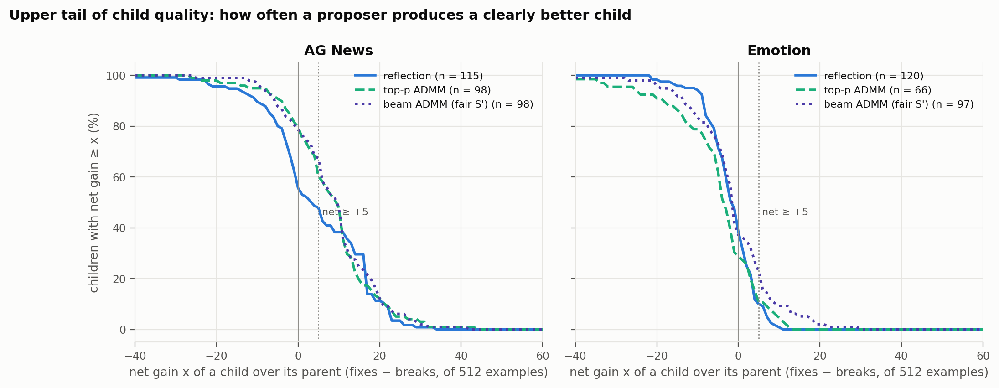

# Results log

New results after [`CLASSIFICATION_RESULTS.md`](CLASSIFICATION_RESULTS.md), whose last update
covers Phases 1–6 and the fluency analysis (2026-10-06). Entries are newest last. Detailed
tables live in generated files linked from each section; this log keeps the plots and the
takeaways.

**Naming:**
- "GEPA + … ADMM proposer": ADMM replaces GEPA's reflection step. "Standalone ADMM" means the
  pilot only.
- "Fair S′": children are accepted on an independent held-out batch (Phase 6).
- "S used twice": the earlier version, which accepted on the same batch that chose the
  candidate.

**No new optimization seeds were added in this period.** The new numbers come from a larger
evaluation set and from re-analysis of existing runs. Phase 7 (the first new runs) is in
progress.

## Key takeaways
- **Emotion:** fair beam ADMM beats both reflective baselines on 2k examples (+1.1 pp,
  p ≈ 0.01). Reflection doesn't beat the seed instruction.
- **AG News:** fair beam ADMM vs. matched reflection is still a tie (+0.9 pp, p = 0.33).
  Top-p ADMM vs. reflective GEPA holds (+2.6 pp, p = 0.02).
- **AG News variance is real run-to-run variation,** not measurement noise. More seeds help
  there; more evaluation examples don't.
- **Three seeds were misleading:** an early 4 pp AG News lead shrank to about 1 pp at 10 seeds.
- **ADMM time:** 93% of runtime is inside ADMM proposals, mostly the projection step.
- **The ADMM iterate oscillates,** so it keeps the best candidate seen rather than the last
  round.
- **Reflection vs. ADMM edits:** reflection rewrites about 40% of the text, ADMM edits
  1–3 tokens. Both change 12–18% of predictions. ADMM's changes break fewer examples.
- **Final accuracy follows the best children,** not the average one; this is why per-proposal
  averages and accuracy can look different.
- **GEPA's minibatch rule misses many better children** (ties on 8 examples).

---

## 2026-10-15

### Larger report sets (2,000 examples per task)
- **Why:** the 256-example report half has a standard error of about 3 pp per run, comparable
  to the whole seed-to-seed spread.
- **What:** a class-stratified set per task, drawn from the unused part of each official
  training split. It doesn't overlap train or validation; the test splits stay locked.
  - AG News: 2,000 examples (500 per class).
  - Emotion: 2,004 examples (334 per class).
- **Code:** [`report_set.py`](src/gepa_pilot/report_set.py) (`prepare`). **Data:**
  `artifacts/data/report.json`, `artifacts/data_emotion/report.json`.

### Re-scoring every existing run on the 2,000-example sets (Stage 0)
- **What:** each finished run's selected prompt (selection unchanged) scored on the large set;
  111 AG News runs plus all emotion runs.
- **Code:** `report_set.py rescore`. **Results:** [`artifacts/report2k/`](artifacts/report2k/).

**Headline (10 seeds, 2k report sets, mean ± sd):**

| Arm | AG News | Emotion |
|---|---:|---:|
| Seed instruction | 28.90 | 37.03 |
| Reflective GEPA (12 proposals) | 32.95 ± 1.98 | 36.81 ± 0.41 |
| Matched reflective (30 proposals, held-out) | 34.09 ± 1.21 | 36.79 ± 0.66 |
| GEPA + top-p ADMM proposer | 35.59 ± 2.63 | 37.03 ± 0.07 |
| GEPA + beam ADMM proposer (S used twice) | 36.98 ± 2.70 | 37.23 ± 0.46 |
| **GEPA + beam ADMM proposer (fair S′)** | **35.02 ± 2.66** | **37.92 ± 0.99** |

- **Emotion, fair beam ADMM minus:**
  - matched reflective: **+1.13 pp, p = 0.009**;
  - reflective GEPA: **+1.11 pp, p = 0.007**.
- **AG News, fair beam ADMM minus:**
  - matched reflective: +0.93 pp, p = 0.33;
  - reflective GEPA: +2.06 pp, p = 0.066.
- **Emotion:**
  - significance improves from p = 0.03 on 256 examples to p < 0.01;
  - reflection ends slightly below the seed; ADMM is about +0.9 pp above it.
- **AG News:**
  - every method is 4–6 pp above the seed;
  - the spread barely shrinks (fair beam sd 3.7 → 2.7 pp), so the variance is genuine;
  - the 256-example half overstated the seed (30.9 vs. 28.9).

### New code, checked before use
- **Multi-length ADMM proposer** (`--admm-length-offsets 0 -2 2`):
  - Per proposal, also refines a 2-token-shorter variant (lowest-saliency tokens removed) and a
    2-token-longer one (the LM's top token inserted at the highest-saliency positions).
  - All candidates are pooled, chosen on S, and judged on S′.
  - Code: `_length_variant`, `_refine_from` in
    [`admm_proposer.py`](src/gepa_pilot/admm_proposer.py).
- **Fair reflect-then-polish:** the held-out judge wraps the beam polish and compares the final
  child with GEPA's parent on S′ (`--proposer reflect_polish --reflection-acceptance heldout`).
- **Shared-GPU queue** ([`scripts/gpu_queue.py`](scripts/gpu_queue.py)):
  - picks the GPU with the most free memory;
  - caps jobs per GPU and retries out-of-memory failures;
  - flags runs where GEPA swallowed proposal errors.
- **Checks:**
  - Single-length regression: proposal logs and event streams are identical to the old code in
    deterministic mode.
  - Fair-polish wiring: the judge's batch equals S′ and doesn't overlap S or the minibatch.
  - Multi-length smoke test:
    - proposal 1: the shorter variant was accepted on S′ (25.0 → 31.3%);
    - proposal 2: the longer variant was rejected on S′ (25.0 → 21.9%).
- **Silent-failure risk:**
  - An in-place tensor edit crashed every multi-length proposal; fixed.
  - **GEPA catches proposal exceptions, logs them and continues**, so a run can "succeed" while
    proposing nothing.
  - All 189 earlier run logs were scanned: none had swallowed errors.

### Phase 7 launched, then restarted
- **Batch:** fair reflect-then-polish and multi-length beam ADMM proposer, 10 seeds × 2 tasks
  (40 runs), on GPUs 4–7 via the queue ([`scripts/run_phase7.sh`](scripts/run_phase7.sh)).
  Auto re-scores on 2k at the end.
- **Incident:** two `git stash -u` at 23:48–23:49 moved in-progress outputs.
  - The AG News re-scoring had finished; its results were restored from the stash.
  - The 8 runs in flight were discarded; the batch restarted at 23:53.
  - In-progress run directories are now git-ignored.

---

## 2026-10-16

### Where the time goes: ADMM, not GEPA
- **Beam / top-p ADMM proposer runs (Phases 2 and 6):** 261–272 s of optimization, of which
  240–251 s (92–93%) is inside ADMM proposals. GEPA's own evaluations take about 20 s.
- **Phase 7 (shared GPUs):** about 290 s per multi-length proposal, about 120 s per
  reflect-then-polish proposal.
- **Within ADMM, the projection dominates:**
  - Euclidean takes about 6 s per proposal; top-p and beam take 15–20 s.
  - Those projections decode token by token (20 rounds × ~26 positions).
  - The speed-up target: batch beams and candidate scoring.
- **Phase 7 runs are 2–3× slower,** because GPUs 4–7 are shared at 100% utilization.

### Small vs. large evaluation set, side by side
Same runs, same selected prompts; only the evaluation set differs (256 vs. ~2,000 examples), so
any difference is evaluation noise. Code:
[`eval_size_comparison.py`](src/gepa_pilot/eval_size_comparison.py). Tables:
[`artifacts/eval_size/tables.md`](artifacts/eval_size/tables.md).

*Figure 8. Each arm's 10 runs on 256 examples (hollow) and on ~2,000 (filled), with mean ± 95%
CI. Dotted and dashed lines: the seed instruction.*

*Figure 8b. Key differences ± 95% CI (Welch) on each evaluation set; bold p < 0.05.*

- **The level shifts with the set:** the 256-example half was easier on AG News (seed 30.9 vs.
  28.9) and harder on emotion (35.9 vs. 37.0). Compare arms, not absolute levels.
- **Spread shrinks where the noise was measurement noise:**
  - emotion ADMM arms: sd −50% to −73% (fair beam 1.98 → 0.99);
  - AG News: only −10% to −29%; top-p even +18%, so the variance is real.
- **Comparisons:**
  - Emotion, fair beam vs. matched reflective: smaller but more certain (+1.64 → +1.13 pp;
    p 0.030 → 0.009).
  - Emotion, top-p vs. reflective GEPA: a **false positive** on 256 (p 0.016 → 0.134).
  - AG News, fair beam vs. matched reflective: still not significant (0.00 → +0.93 pp,
    p = 0.33).
  - AG News, top-p vs. reflective GEPA: holds (p 0.041 → 0.021).
- **For future runs:** score on 2k by default (Phase 7 does). For AG News, add seeds, not
  examples.

### How results change with the number of seeds
The first n seeds (in run order) at n = 3, 5, 10. Code:
[`seed_count_analysis.py`](src/gepa_pilot/seed_count_analysis.py). Full tables (both measures,
all arms): [`artifacts/seed_count/tables.md`](artifacts/seed_count/tables.md).

*Figure 11. Left: arm mean ± 95% CI on 2k examples using the first n seeds. Right: fair beam
ADMM minus matched reflective, ± 95% CI, with p-values.*

- **Three seeds weren't enough on AG News:**
  - 95% CI of ±3–9 pp at n = 3;
  - the first seeds favored ADMM: fair beam's lead fell from +4.3 to +0.9 pp (2k);
  - early choices made at n = 3 (e.g. beam λ = 0.3) rested on optimistic numbers.
- **Emotion is the reverse:** the advantage grows and sharpens, from +0.08 pp (p = 0.85) at
  n = 3 to +1.13 pp (p = 0.009) at n = 10.
- **About 30–40 seeds per arm** would be needed to resolve a 1 pp difference on AG News.

### ADMM: the best candidate is rarely from the last round
Each ADMM proposal runs 20 rounds, scores every new candidate on S, and returns the best.
Code: [`iterate_diagnostics.py`](src/gepa_pilot/iterate_diagnostics.py). Per-arm numbers:
`artifacts/iterate_diagnostics/summary.json`.

*Figure 7a. The round each returned candidate came from (fair beam ADMM proposer). Median round
12–13; round 20 supplies only 7 of 98 (AG News) and 5 of 97 (emotion).*

*Figure 7b. What "take the last round" would return: mostly the parent itself (72% AG News, 53%
emotion), otherwise a revisit or a worse candidate. The unlabeled AG News segment is 8%.*

*Figure 7c. One AG News proposal from the seed instruction. It visits several 1–5 token edits
(e.g. "ignore **linguistic** details", "**Pleasefully** determine…"), returns its best at
S-loss 9.46, and ends round 20 back at the parent (11.76).*

- **Oscillation, not convergence:**
  - the iterate returns to the parent 1.5–4 times per proposal;
  - in round 20 it is the parent in 53–82% of proposals.
- **The returned candidate is from round 20 in only 2–15% of proposals.**
- **The round-20 candidate is worse on S** than the returned one in 82–98% of cases (+0.25 to
  +1.0 nats).
- **Why:**
  - the dual u builds up and the projection jumps to a new token;
  - the residual then reverses, u unwinds, and the projection jumps back;
  - top-p and beam always keep the parent's token available.
- **Implication:** pooling candidates across refinements (multi-length) is sound; taking the
  last round is not.

### What each proposer changes: text vs. predictions
Code: [`proposal_diagnostics.py`](src/gepa_pilot/proposal_diagnostics.py),
[`proposal_examples.py`](src/gepa_pilot/proposal_examples.py). Supplementary tables (worked
examples with real articles, like-for-like and pooled tables, acceptance tables, rejected-but-
better prompts): [`artifacts/proposal_diagnostics/examples.md`](artifacts/proposal_diagnostics/examples.md).

#### Definitions
- **Proposal:** one parent → child step in GEPA. Both prompts were scored on the same **512
  validation examples**, so each example's prediction can be compared.
- **Each example falls into one category:**
  - *unchanged:* same prediction (correct or wrong); not a flip;
  - **fix:** parent wrong → child correct;
  - **break:** parent correct → child wrong;
  - **wrong → different wrong:** e.g. World → Sports when the answer is Business.
- **Flips** = fixes + breaks + wrong → different wrong (predictions that changed).
- **Flip rate** = flips / 512.
- **Net** = fixes − breaks = the accuracy change in examples (÷ 512 = accuracy change).
- **Text edited** = token edit distance / the longer prompt's length.
- **Counted:** proposals whose child differs from the parent, accepted or rejected (step 2 of
  GEPA's loop, before acceptance).
- **Excluded:** the proposer returned the parent unchanged. This happens with ADMM only, when it
  finds nothing better on S; it occurs in 18–45% of ADMM proposals.
- **Like-for-like:** one experiment per proposer, 10 runs × 12 proposals, same protocol.

**Worked examples (AG News):**
- **Typical reflection proposal:** rewrites about half the sentence ("Carefully determine the
  article's main topic…" → "Carefully analyze the article to identify the central topic…").
  - 19 fixes, 19 breaks, 51 wrong → different wrong;
  - 89 flips (17%), net 0.
- **Typical beam ADMM proposal:** "and output only" → "and Output ONLY".
  - 24 fixes, 13 breaks, 22 wrong → different wrong;
  - 59 flips (12%), net +11 (+2.15 pp).

*Figure 9b. Mean fixes, breaks and wrong → different wrong per changed prompt. Right of each
bar: net per change, net per proposer call (no-change proposals count as 0), and how many of
the 120 proposals changed the prompt.*

*Figure 9. AG News, one point per proposal: text edited (x) vs. flip rate (y); ★ = median.*

- **Both kinds of proposal move many predictions:**
  - reflection: about 40% of the text edited → about 17% of predictions changed;
  - ADMM: about 4% (1–3 tokens) → 12–15%, about 10× more per edited token.
- **The difference is direction, not size (AG News):**
  - every proposer fixes about 24–27 examples;
  - reflection breaks 21.8, ADMM 16.3–19.3;
  - net per change: reflection +4.1, ADMM +7.3 to +7.9;
  - per call: +3.9 vs. +6.0 to +6.4.
- **About half of all flips are wrong → different wrong:** behavior changes without any
  accuracy change.
- **Emotion:** every proposer is slightly break-heavy (net −2.0 to −5.7 per change).
- **Correction:** `CLASSIFICATION_RESULTS.md` §5.10 said reflection's paraphrases "don't move
  predictions". They do, just in no consistent direction.

#### Why per-proposal averages can differ from final accuracy
How GEPA uses children:
- a rejected child is discarded, so it costs one proposal and nothing else;
- an accepted child joins the pool and can become a parent, so gains stack;
- GEPA returns the best pool member, so the outcome behaves like a maximum, not an average.

*Figure 9d. Net gain in validation examples (of 512) at each stage: all children and accepted
children (vs. their parent), the best child per run, and the final prompt (vs. the seed).*

*Figure 9c. Share of children whose net gain is at least x.*

- **Per change, ADMM is not worse:**
  - AG News: beam +7.9 vs. reflection +4.1;
  - emotion: beam −2.0 vs. reflection −2.5;
  - only emotion top-p is worse (−5.7), and it ends near the seed.
- **Emotion, the tail differs:**
  - children with net ≥ +5: beam 23%, reflection 10%;
  - best child per run: beam +12.3, reflection +6.5.
- **Accepted children are less harmful:** −0.8 for beam vs. −1.9 for reflection (emotion).
- **More accepted children → more stacking:** 77–79 vs. 25 accepted on AG News.
- **Final prompt vs. seed:**
  - emotion: beam +7.2, reflection −0.3;
  - AG News: ADMM +29 to +33, reflection +18.3;
  - this matches the accuracy results.
- **Caveat:** these are 512-example numbers. An emotion step of ±5 examples is near the noise;
  the 2k sets are the stronger evidence.

### How reliable each acceptance rule is
- **"Actually better"** = net > 0 on the 512 validation examples, which no acceptance rule
  sees.
- **What a good rule does:** accepts mostly better children and rejects mostly worse ones.
- **Tables:** 2×2 tables and the rejected-but-better prompts are in
  [`examples.md`](artifacts/proposal_diagnostics/examples.md).

*Figure 10. Share of accepted (dark) and rejected (light) children that were actually better;
a larger gap means better separation.*

- **GEPA's minibatch rule can't see small edits:**
  - Euclidean ADMM: rejected children were *more* often better (70%) than accepted ones (67%);
  - the largest missed gain tied 2 → 2 on 8 examples but was **+10.55 pp** on validation (a
    garbage-token prompt, yet a real improvement).
- **It also discards good reflection rewrites:**
  - 43 rejected reflection children were actually better (48% of rejections);
  - several were +4 to +5 pp, all ties (e.g. 3 → 3).
- **The held-out judge separates much better:** 72% of accepted vs. 28% of rejected were
  better.
- **ADMM on AG News:** most children are better under any rule, since ADMM only proposes
  children that beat the parent on S.
  - Accepted: 81–87% better; rejected: 53–60%.
  - S′ vs. reusing S looks similar here; the double use showed up in final accuracy (Phase 6).
- **Emotion:** no rule separates (16–38% better either way).
  - The cause is measurement noise: about ±1.6 pp on the net, larger than most emotion
    children move.
  - Treat these rows as uninformative.
- **Caveat:** differences under about 2 pp on 512 examples aren't resolved; the AG News
  contrasts are large enough to be robust.

### Status of Phase 7 (in progress)
- **Runs:** fair reflect-then-polish and the multi-length beam ADMM proposer, 40 runs.
- **Timing:** restarted at 2026-10-15 23:53, expected to finish in the early morning.
- **Check:** `artifacts/phase7/STATUS`.
