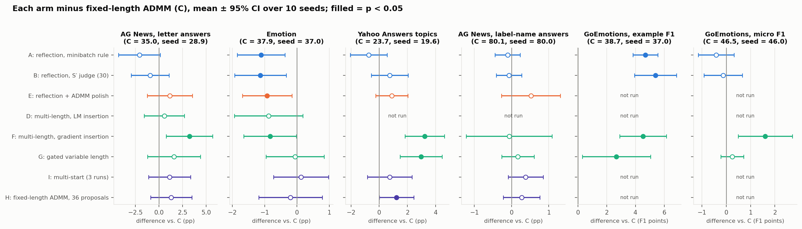
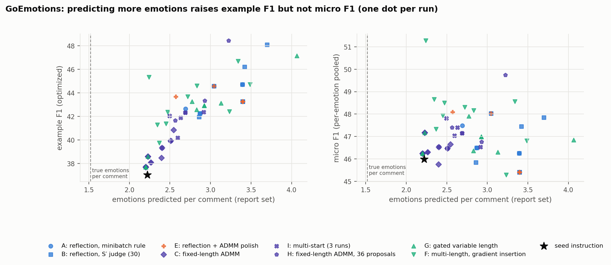

# Results log (2026-10-17 – 2026-10-20)

This log follows [`RESULTS_10_16.md`](RESULTS_10_16.md), which covers AG News (letter answers) and
emotion through Phase 10. This entry adds **three new task settings** and the code adaptations they
needed:
- **Yahoo Answers topics:** a third single-label task.
- **AG News answered with label names:** multi-token answers.
- **GoEmotions:** multi-label.

**Conventions are the same as in `RESULTS_10_16.md`:**
- **Arm letters:** A–I, defined below.
- **Statistics:** 10 seeds per arm; mean ± 95% CI over seeds; Welch's t-tests against C, the
  fixed-length beam ADMM proposer.
- **Hypotheses:** anything not directly measured is marked **Hypothesis**.
- **Numbers:** all come from [`cross_task_analysis.py`](src/gepa_pilot/cross_task_analysis.py),
  with full tables in [`artifacts/cross_task/tables.md`](artifacts/cross_task/tables.md).

---

## Arms (as in `RESULTS_10_16.md`)

| Label | What it is |
|---|---|
| **A** | Reflective GEPA: reflection proposes, GEPA's minibatch rule accepts (12 proposals) |
| **B** | Reflection, S′ judge, **30** proposals (≈ ADMM's compute) |
| **C** | **Fixed-length beam ADMM proposer**, S′ acceptance (reference) |
| **D** | Multi-length ADMM, LM-top-token insertion (AG News letters and emotion only) |
| **E** | Reflection + ADMM polish, S′ judge |
| **F** | Multi-length ADMM, gradient-chosen insertion |
| **G** | Gated variable-length ADMM |
| **H** | C with 36 proposals (3× compute) |
| **I** | Multi-start: 3 ADMM runs per proposal (3× compute) |

## Method specifications: D, E, F, G

Formulation and implementation, written as Python-style pseudocode with a comment on each step.
The real code is in [`admm_proposer.py`](src/gepa_pilot/admm_proposer.py),
[`gated_admm.py`](src/gepa_pilot/gated_admm.py) and [`objective.py`](src/gepa_pilot/objective.py).
Every method is a **proposer** inside the same GEPA loop: GEPA picks a parent (Pareto rule) and an
8-example minibatch, the proposer returns one child, and the child is accepted or rejected.

### Shared core: fixed-length ADMM refinement, projection and acceptance (this alone is arm C)

```python
# Notation
#   x        parent instruction, as tokens x_1..x_L        E(w)   embedding of token w
#   prefix   the fixed prompt text before the instruction slot (system message + chat template up to
#            the instruction)
#   P_LM(w | prefix, x_<i)
#            next-token probability of token w from the SAME Qwen3-1.7B that does the classification
#            (no separate language model), given the prefix followed by the instruction tokens before
#            position i. Only allowed tokens count: special and control tokens are excluded.
#            It measures how natural w is at that point in the instruction.
#   NLL_LM(w | ·) = −log P_LM(w | ·), the fluency cost in the projection
#   top-p nucleus  the smallest set of most likely tokens under P_LM whose probabilities sum to ≥ p
#   ℓ_B(e)   task loss of slot embeddings e on a batch B (objective.py):
#              single-label: cross-entropy over the label scores
#              multi-label:  1 − soft F1 per text, soft F1 = 2 Σ_k p_k y_k / (Σ_k p_k + Σ_k y_k), p_k = sigmoid(log-odds_k)
#   S, S′    two disjoint 32-example training batches: S picks the candidate, S′ judges acceptance
#   ℓ_S(x)   loss of a discrete prompt x on S (real tokens, no gradients); ℓ_S2(x) the same on S′
#   select_on_S(pool, parent): the candidate with the LOWEST ℓ_S in the pool, if that loss is below
#            the parent's ℓ_S; otherwise the parent itself (= "nothing better found")
#   T        the remaining training examples (ADMM's own training data, drawn 16 at a time)

def admm_refine(x, rounds=20, rho=0.1, lr=0.005, e_steps=3):
    e, z, u = E(x), x, 0                           # continuous copy e, discrete tokens z, scaled dual u
    candidates = {}
    for t in range(rounds):
        B = next_batch(T, 16)                      # a different 16-example batch every round
        for _ in range(e_steps):                   # E-step: move e to lower the task loss,
            e -= Adam(grad_e(ℓ_B(e) + rho/2 * ||e - E(z) + u||**2), lr)   # while staying near the tokens z
        z = beam_project(target=e + u)             # Z-step: closest fluent token sequence (below)
        u += e - E(z)                              # dual step: accumulate the remaining gap e − E(z)
        if z != x and round_trips(z):              # a new prompt that re-tokenizes exactly
            candidates[z] = ℓ_S(z)                 # score it on S with the real tokens (no gradients)
    return select_on_S(candidates, parent=x)       # lowest ℓ_S among all rounds (not the last round,
                                                   # RESULTS_10_16 Q4), and only if it beats the parent on S

def select_on_S(pool, parent):
    best = min(pool, key=ℓ_S)                      # the candidate with the lowest loss on S
    return best if ℓ_S(best) < ℓ_S(parent) else parent   # no candidate beats the parent: return the parent

def beam_project(target, lam=0.3, top_p=0.99, width=4):
    # Left to right, keeping the `width` cheapest partial sequences. At position i the allowed tokens are
    # the LM's top-p nucleus given prefix + tokens chosen so far, plus the parent's own token x_i.
    #   cost(w_1..w_i) = Σ_j ||target_j − E(w_j)||²   +   lam · Σ_j NLL_LM(w_j | prefix, w_<j)
    #                    └ close to the ADMM target ┘      └ fluent text ┘
    return cheapest full sequence

def accept(child, parent):                         # the fair S′ judge used by every ADMM arm and by E
    return ℓ_S2(child) < ℓ_S2(parent) and metric_S2(child) >= metric_S2(parent)
    # metric = accuracy, or mean comment F1 for GoEmotions; S′ is disjoint from S, the minibatch and T

def propose_C(parent):
    child = admm_refine(parent)                    # one fixed-length refinement
    return child, accept(child, parent)
```

### D and F: multi-length ADMM (D = LM insertion, F = gradient-chosen insertion)

```python
def propose_multilength(parent, insert_two):       # D: insert_two = insert_two_lm;  F: insert_two_gradient
    B = first_batch(T, 16)
    s = [norm(grad_{e_i} ℓ_B(E(parent))) for i in range(L)]   # saliency: how strongly the loss reacts to token i
    short = delete(parent, two_smallest(s, exclude_last=True)) # 2-token-shorter prompt
    long_ = insert_two(parent, s)                              # 2-token-longer prompt
    pool  = {short, long_}                         # the raw variants are candidates themselves
    for start in (parent, short, long_):           # three refinements, each keeping its own length
        pool |= candidates_of(admm_refine(start))
    child = select_on_S(pool, parent)              # lowest ℓ_S over all three lengths, if it beats the parent
    return child, accept(child, parent)

def insert_two_lm(x, s):                           # D
    for g in two_largest(s):                       # before the 2 most loss-sensitive tokens
        w = argmax_w P_LM(w | prefix, x[:g])       # the LM's single most likely next token: no task signal
        x = x[:g] + [w] + x[g:]
    return x

def insert_two_gradient(x, s):                     # F: two insertions, one at a time
    for _ in range(2):
        trials = []
        for g in six_largest(s):                   # 6 candidate POSITIONS (gaps before the most salient tokens)
            w0   = argmax_w P_LM(w | prefix, x[:g])                   # placeholder word at this gap
            grad = grad_{e_g} ℓ_B(E(x[:g] + [w0] + x[g:]))            # loss gradient at the inserted slot
            W    = top_k(P_LM(. | prefix, x[:g]), 64)                 # fluency filter: the LM's 64 likeliest words
            delta = {w: (E(w) - E(w0)) @ grad for w in W}             # predicted loss change if w replaces w0
            W8   = 8 words of W with the most negative delta          # 8 candidate WORDS per gap: predicted to
                                                                      # lower the loss most (GCG-style)
            trials += [(g, w) for w in {w0} | W8]                     # up to 9 trials per gap, 54 in total
        # Check step: build each trial's instruction (its own word at its own gap), score it with the REAL
        # tokens on 32 training examples (the first 32 of ADMM's pool T; on GoEmotions T has only 24), and
        # keep the pair with the lowest loss. Trials that do not re-tokenize exactly are skipped.
        g, w = min(trials, key=lambda gw: ℓ_32(x[:gw[0]] + [gw[1]] + x[gw[0]:]))
        x = x[:g] + [w] + x[g:]
    return x
```

| | D: LM insertion | F: gradient insertion |
|---|---|---|
| Cost vs. C | about 2.9× (three refinements) | about 3.4× (plus the insertion search) |
| Insertion settings | LM top 1 | LM top 64 (fluency filter) → 8 per gap by gradient → exact loss; 6 gaps. **Not tuned** |

**"GCG-style"** refers to Greedy Coordinate Gradient, the standard way to search over discrete tokens
with gradients:
- GCG: Zou, Wang, Carlini, Nasr, Kolter, Fredrikson (2023), *Universal and Transferable Adversarial
  Attacks on Aligned Language Models*,
  [arXiv:2307.15043](https://arxiv.org/abs/2307.15043).
- It builds on AutoPrompt: Shin, Razeghi, Logan, Wallace, Singh (2020), *AutoPrompt: Eliciting
  Knowledge from Language Models with Automatically Generated Prompts*, EMNLP 2020,
  [arXiv:2010.15980](https://arxiv.org/abs/2010.15980).

How it works:
- **Estimate:** one backward pass estimates, for every vocabulary token w, how much the loss would
  change if w replaced the current token: (E(w) − E(current)) · ∇.
- **Shortlist and check:** the top-k by that estimate are scored exactly, and the best is kept; GCG
  repeats this for many rounds.
- **F's insertion uses the same estimate-then-check trick,** with three differences:
  - it inserts at a gap rather than swapping a token;
  - candidates are restricted to the LM's 64 likeliest words;
  - it runs once per inserted token, after which ADMM takes over.
- **Why the filter:** unconstrained GCG is known to produce gibberish that still lowers the loss.
  F's first, unfiltered version did the same ("correspondingetine").
| Flags | `--admm-length-offsets 0 -2 2` | `--admm-length-offsets 0 -2 2 --admm-insertion gradient` |
| Run on | AG News (letters), emotion | all five settings |

**D examples** (AG News with letters, accepted; change in correct answers out of 512 validation
examples):
- **Shorter variant, +31** (D's most common winning edit):
  - `delete` picks the two least salient tokens, which are just the commas: "… from the label
    ~~mapping,~~ **mapping** ignore incidental ~~details,~~ **details** and output …"
  - `admm_refine` then rewrites the freed span: "… from the label ~~mapping, ignore incidental
    details,~~ **mapping and provide details** and output only the corresponding capital letter."
- **Longer variant, −10:** `insert_two_lm` duplicates a nearby word ("… the corresponding
  **label** capital **label** letter"), and ADMM only partly repairs it ("… **label** capital
  **letter** letter").
- **Result:** on AG News the longer variant won only 16 of D's 114 proposals.

**F examples** (accepted, from the longer variant):
- **Yahoo, +24 correct answers of 1,280:**
  - `insert_two_gradient` inserts "Carefully **remove** determine the question's main topic … the
    corresponding ~~capital~~ **capital-letter** letter";
  - `admm_refine` then edits it to "… from the label ~~mapping, ignore incidental~~ **mapping. This
    entails** details, …".
- **GoEmotions, +8.4 F1 points:**
  - inserted: "Carefully decide whether the **person** comment expresses the **emotion** candidate
    emotion …";
  - accepted child: "… the **person** comment expresses the ~~candidate~~ **emotion of** emotion …".
- **Result:** the inserted words carry task signal, so the longer variant won 101 of F's 116 proposals
  on AG News. But they are often ungrammatical, which is F's fluency cost.

### G: gated variable-length ADMM

**Idea:** make "is this token present?" a continuous quantity that ADMM optimizes together with the
token embeddings. The prompt can then lose tokens or gain new ones in any ADMM round, rather than
only at the start of a proposal (as in D and F).

**Slots.** G works on a sequence of *slots* built from the parent instruction:
- **Parent slots:** one per token of the parent instruction. They start present, holding the
  parent's token.
- **Spare slots:** 4 extra slots, inserted before the 4 parent tokens with the largest saliency
  (loss gradient norm, as in D/F). They start (almost) absent; a spare slot that turns on becomes an
  inserted word.

| Symbol | Meaning | Initial value |
|---|---|---|
| e_i | continuous embedding of slot i; optimized by Adam | parent slot: E(parent token). Spare slot: E(the LM's most likely token at that position) |
| a_i | **gate logit** of slot i: an unconstrained number optimized by Adam (learning rate 0.1) | parent slot **+4**, spare slot **−2** |
| g_i = sigmoid(a_i) | **keep-gate**: how present slot i is in the prompt, between 0 and 1 | parent ≈ 0.98, spare ≈ 0.12 |
| k_i | **discrete decision** for slot i from the latest projection: 1 = holds a token, 0 = blank | parent 1, spare 0 |
| z_i | the token in slot i when k_i = 1 | parent token (spares blank) |
| u_i | ADMM dual for the embedding: accumulated gap between e_i and E(z_i) | 0 |
| v_i | ADMM dual for the gate: accumulated gap between g_i and k_i | 0 |
| t_i = g_i + v_i | gate target that the projection sees | |

`a`/`g` play the role for presence that `e` plays for token identity: the continuous variable.
`k` plays the role of `z`: the discrete decision that the continuous variable must eventually agree
with.

**ADMM problem formulation.** One ADMM over the combined per-slot variable (embedding, gate); the
two duals correspond to the two constraints, not to two ADMM loops.

$$
\min_{e,\,a,\,z,\,k}\; f\big(e,\,g\big) + h(z,k)
\quad\text{s.t.}\quad k_i\,\big(e_i - E(z_i)\big) = 0,\;\; g_i = k_i \;\;\forall i,
\qquad g_i=\sigma(a_i),\; z_i\in V,\; k_i\in\{0,1\},\; k_n=1
$$

- $n = L + 4$: the slot layout is fixed **before** ADMM starts (in `init_state`). It holds the
  parent's $L$ tokens plus 4 spare slots placed before the 4 most salient parent tokens; a spare
  slot simply starts with $k_i=0$ (blank) and $a_i=-2$. ADMM never adds or moves slots, so
  insertions can only happen at those 4 places (at most +4 tokens per proposal), while deletions can
  happen at any parent slot. Each GEPA proposal places its own spares on its own parent.
- $f(e,g)$: task loss of the gated soft prompt (cross-entropy, or $1-$ soft F1 for multi-label),
  computed with attention logit to slot $i$ $+\log g_i$ and positions advancing by $g$.
- $h(z,k) = \lambda \sum_{i:\,k_i=1} \mathrm{NLL}_{LM}(z_i \mid \text{prefix}, \text{earlier present tokens})$,
  plus hard constraints: $z_i$ is in the LM's top-$p$ nucleus or equals the parent's token, and the
  final slot is present.
- **Constraints:** a present slot's embedding must be a real token's embedding (blank slots are
  free), and each gate must equal its 0/1 decision.

Scaled augmented Lagrangian (duals $u_i\in\mathbb{R}^d$, $v_i\in\mathbb{R}$):

$$
L = f(e,g) + h(z,k) + \frac{\rho}{2}\sum_i k_i\,\lVert e_i - E(z_i) + u_i\rVert^2 + \frac{\rho_g}{2}\sum_i \big(g_i - k_i + v_i\big)^2
$$

Each of the 20 rounds:
1. **$(e,a)$-step:** 3 Adam steps on $L$ over $(e,a)$ with a 16-example batch ($\rho=0.1$,
   $\rho_g=1$; learning rates 0.005 for $e$ and 0.1 for $a$).
2. **$(z,k)$-step:** beam search (width 4) on $L$ over $(z,k)$. Per slot, with $t_i=g_i+v_i$: blank
   costs $\propto t_i^2$, token $w$ costs $\propto (1-t_i)^2 + \lVert e_i+u_i-E(w)\rVert^2 + \lambda\,\mathrm{NLL}_{LM}(w\mid\cdot)$.
3. **Duals:** $u_i \leftarrow k_i\,(u_i + e_i - E(z_i))$ (reset for blanks); $v_i \leftarrow v_i + g_i - k_i$.
4. **Candidate:** the present tokens $\{z_i : k_i=1\}$ form a discrete prompt, scored on S.

**Where the implementation deviates from this:**
- **The $(z,k)$-step is reweighted.** It uses gate weight $\gamma=10$ instead of $\rho_g/2$, and
  token distances measured relative to the closest candidate token without the $\rho/2$ factor.
  Absolute distances drift during ADMM while a blank has no embedding to compare, so unscaled
  distances made the beam delete almost everything in the first smoke test.
- **It's a heuristic:** non-convex and partly discrete, with no convergence guarantee. That is why
  the best candidate over all rounds is kept, not the last iterate.

**How a gate acts on the model** (the relaxation):
- the attention logit from every later token to slot i gets + log g_i;
- the position index of slot i is p0 + Σ_{j<i} g_j (positions advance by the gates before it).
- So g_i = 1 is the ordinary token; g_i → 0 is *exactly* the prompt without that token (checked to
  1e-4 logits); values in between are "partly present".

**Why +4 and −2:**
- **+4 for parent slots** (g ≈ 0.98, log g ≈ −0.02): the starting prompt is essentially the parent
  itself.
- **−2 for spare slots** (g ≈ 0.12, log g ≈ −2.1) is a compromise:
  - small enough that a spare barely changes the starting prompt;
  - not 0, because the attention paid to a slot scales with g. A spare at g ≈ 0 would have no
    influence on the output, so its embedding would get no gradient and it could never learn to
    open. At g ≈ 0.12 it has a small, measurable effect, and gradients reach both its embedding and
    its gate.
- **These values were not tuned.**

```python
def propose_G(parent, n_spare=4, rho=0.1, rho_g=1.0):
    s = saliency(parent)                           # loss-gradient norm per parent token (as in D/F)
    slots = insert n_spare spare slots before the n_spare most salient parent tokens
    e = [E(token) if parent slot else E(argmax P_LM at that position) for slot in slots]
    a = [+4.0 if parent slot else -2.0 for slot in slots]      # gates start ≈ 0.98 (present) / ≈ 0.12 (almost absent)
    k = [1 if parent slot else 0 for slot in slots]            # discrete decision: token (1) or blank (0)
    z = [parent token if parent slot else None for slot in slots]
    u, v = 0, 0                                                # duals for embeddings and gates
    for t in range(20):                                        # ADMM rounds
        B = next_batch(T, 16)
        for _ in range(3):                                     # E-step: Adam on e (lr 0.005) and a (lr 0.1)
            g = sigmoid(a)
            L = (ℓ_B(e, g)                                     # task loss of the gated prompt
                 + rho / 2 * Σ_i k_i * ||e_i - E(z_i) + u_i||**2   # filled slots: keep e near their token
                 + rho_g / 2 * Σ_i (g_i - k_i + v_i)**2)           # every slot: keep the gate near its decision
            e, a = Adam(grad(L))
            # The task loss can pull a spare's gate up (if the half-present word helps) or a parent
            # token's gate down (if removing it helps); the penalty terms pull both back toward k.
        z, k = gated_beam(target=e + u, gate_target=sigmoid(a) + v)   # Z-step: blank or token per slot
        u = [k_i * (u_i + e_i - E(z_i)) for i]                 # embedding dual (reset to 0 when blank)
        v = v + sigmoid(a) - k                                 # gate dual: a gate that keeps disagreeing with
                                                               # its decision builds up until the decision flips
        x_t = [z_i for i if k_i == 1]                          # the discrete prompt: blanks removed
        if x_t is new and round_trips(x_t):
            candidates[x_t] = ℓ_S(x_t)                         # score on S with the real tokens
    child = select_on_S(candidates, parent)                    # lowest ℓ_S over all rounds, if it beats the parent
    return child, accept(child, parent)

def gated_beam(target, gate_target, gamma=10.0, lam=0.3):
    # Left to right, beam width 4. For slot i with gate target t_i, each beam extends with either
    #   blank:   cost  gamma · t_i²                            low when the gate says "off"
    #   token w: cost  gamma · (1 − t_i)²                      low when the gate says "on"
    #                + ||target_i − E(w)||² − min_w' ||target_i − E(w')||²   closeness to the slot's embedding,
    #                                                          relative to the closest allowed token
    #                + lam · NLL_LM(w | prefix, tokens chosen so far)        fluency
    #   (w ranges over the LM's top-p nucleus at that point, plus the parent's token for parent slots)
    # With gamma = 10, a slot switches between blank and token roughly when t_i crosses 0.5.
    # The final slot (the token carrying the trailing newline) is never blank.
    return the cheapest sequence of choices
```

**Worked example** (parent "…output only the corresponding capital letter.", with a spare slot
before "capital"):
1. **Start:** the spare holds the embedding of the LM's likeliest word there, say "label", at
   g ≈ 0.12. The model sees "…corresponding *(faint label)* capital letter."
2. **E-steps:** if the faint "label" lowers the task loss, the gradient raises its gate logit, and the
   embedding moves toward whatever helps most.
3. **Projection:** while t = g + v stays below about 0.5, blank is cheaper and the spare stays empty;
   the dual v slowly builds up. Once t passes about 0.5, a token is cheaper, and the beam picks a
   fluent token near the spare's embedding, here "label".
4. **Candidate:** the new discrete prompt "…output only the corresponding **label** capital
   letter." is scored on S. After 20 rounds, the best candidate on S is proposed and judged on S′.
5. **Deletions** work the same way in reverse: a parent token whose gate the task loss pushes down
   eventually becomes blank. In practice this is rare; parent gates tend to rise toward 1.

**Cost:** about 1.1× C in forward passes. It has one refinement, like C, and no separate insertion
search. It still uses the LM in every round, as all ADMM arms do: the task loss in the E-steps, and
the nucleus plus fluency term in the projection. Its projection recomputes the prefix without a
cache, so each pass is longer than C's.

**Flags:** `--admm-gated` (spare slots `--admm-spare-slots 4`, gate weight `--admm-gate-weight 10`).

**Examples** (accepted):
- **Yahoo, +99 correct answers of 1,280:** one spare slot opened and one parent token swapped by the
  Z-step: "Carefully ~~determine~~ **classify** the **following** question's intent by topic from the
  label mapping, …"
- **GoEmotions, +8.1 F1 points:** one spare slot opened: "Carefully decide whether the comment
  expresses the ~~candidate~~ **candidate's** emotion …"
- **Result:** edits are small and mostly fluent, typically one opened spare plus a token swap.
  Parent tokens are rarely deleted.

### E: reflect-then-polish

```python
def propose_E(parent, minibatch):
    draft = reflection_LM(parent, mistakes(parent, minibatch))  # GEPA's reflective rewrite, as in arm A
                                                                # (the same Qwen3-1.7B writes it)
    child = admm_refine(draft)               # C's fixed-length beam ADMM, started from the draft; it returns
                                             # the draft unchanged if no candidate beats the draft on S
    return child, accept(child, parent)      # judged against GEPA's parent on S′, not against the draft
```

- **Cost:** about 1.3× C (one reflection call plus one ADMM refinement).
- **Flags:** `--proposer reflect_polish --reflection-acceptance heldout --admm-acceptance-batch-size 32`.
- **Example** (Yahoo, accepted, +34 correct answers of 1,280 vs. GEPA's parent):
  - `reflection_LM` writes "Carefully analyze the question to ~~extract~~ **identify** the primary
    topic, **focusing on the core subject matter and** ignoring any incidental details or keywords,
    and select the corresponding capital letter from the label mapping."
  - `admm_refine` changes one phrase: "… and select the corresponding ~~capital letter~~ **topic
    label** from the label mapping."

More examples (the largest and median accepted child of each method and task):
[`artifacts/cross_task/examples.md`](artifacts/cross_task/examples.md). The quoted effects are
diagnostics on the validation audit, which GEPA never sees:
- AG News: the change in correct answers out of 512;
- Yahoo: the change in correct answers out of 1,280;
- GoEmotions: the change in mean comment F1, in points.

---

## Summary

- **Gradient-chosen insertion (F) is the most consistently helpful ADMM variant:**
  - **Yahoo:** +3.2 pp over C (p < 0.001), and +2.0–2.5 over the equal-compute controls
    (p ≤ 0.01);
  - **AG News with letters:** +3.2 pp;
  - **GoEmotions:** the only arm that improves per-emotion recognition (micro F1 +1.6 over C,
    +1.7 over matched reflection; both p ≤ 0.01). Against the equal-compute controls the micro-F1
    gain shrinks to +1.2–1.3 (p = 0.03–0.06), suggestive rather than settled.
  - It doesn't help on emotion, and nothing helps on AG News with label names.
- **Yahoo** (10 topics, seed instruction 19.6%) confirms variable length beyond compute:
  - both F (+3.2) and gated G (+3.0) clearly beat C;
  - the 3× compute controls gain only about +1;
  - reflection and polish don't differ from C.
- **AG News answered with label names starts at 80% and nothing improves it** (all arms within
  +0.6 pp). With letters the seed instruction scores 29%.
  - **Hypothesis:** most of the earlier AG News gains came from learning the letter mapping, not
    from classifying better.
- **GoEmotions (multi-label):** after fixing the setup (optimize the reported metric, at the
  natural label rate), every arm still learns to **hedge**, listing extra emotions, because
  example F1 rewards it.
  - Reflection's and polish's example-F1 gains (+4.7 to +5.4 over C) are almost entirely hedging:
    micro and macro F1 are flat.
  - F gets the same example-F1 gain with less hedging and is the only arm that improves micro and
    macro F1.

---

## What was added

### A third single-label task: Yahoo Answers topics
I screened three single-input, single-token candidates by scoring the seed instruction and three
hand-written instructions on validation:

| Task | Seed instruction | Best hand-written instruction | Chance | Notes |
|---|---:|---:|---:|---|
| SST-5 (5 sentiment levels) | 39.1% | 39.8% | 20% | rewording barely matters |
| **Yahoo (10 topics, question titles)** | **19.5%** | **25.4%** | 10% | rewording alone gains about 6 pp; the seed sends 58% of answers to one class |
| DBpedia-14 (entity types) | 45.0% | 43.6% | 7% | same collapse onto one class, but rewording doesn't help; long inputs |

- **The pick:** Yahoo, for the most room to improve and its short, fast inputs.
- **Data:** 64 train and 128 validation examples per class; the 2k report set has 200 per class,
  drawn from unused training data. Configs: [`configs/yahoo.yaml`](configs/yahoo.yaml) (plus
  `sst5.yaml`, `dbpedia.yaml` for the screened candidates).

### Code adaptations (all keep the original single-label, letter-answer runs bit-identical)
- **Several text inputs per example:**
  - `task.text_field` can be a list (e.g. premise and hypothesis), written into the input block as
    "Heading: value" lines;
  - the instruction slot is unchanged, so ADMM needs nothing new;
  - tested end to end on RTE ([`configs/rte.yaml`](configs/rte.yaml)), but not run, because RTE's
    seed instruction already scores 85%.
- **Multi-token answers** (`prompt.answer_style: name`):
  - the model answers with the label name, and each class is scored by the likelihood of its full
    answer;
  - the prompt runs once; its KV cache is repeated per class and only the label tokens are added;
    logits are computed only at label positions;
  - matches brute force within 0.0002; gradients reach embeddings and gates; gate = 0 is still
    exact deletion.
- **Multi-label** (`task.multi_label`): described in the GoEmotions section below.
- **Verification that old runs are unaffected:**
  - letter-style prompts and reflection templates are byte-identical;
  - evaluation, ADMM discrete metrics and soft-slot scores are identical;
  - two ADMM steps and two gated steps on AG News are bit-identical before and after.

---

## Results across all five settings



*Figure 18. Each arm minus C (fixed-length ADMM), mean ± 95% CI over 10 seeds, per task setting;
filled = p < 0.05. Each panel title gives C's and the seed instruction's score. "Not run" = arm not
included for that setting. GoEmotions is shown twice: example F1 (the optimized metric) and micro F1
(per-emotion recognition, pooled).*

| Arm | AG News, letters | Emotion | Yahoo | AG News, names | GoEmotions, example F1 | GoEmotions, micro F1 |
|---|---:|---:|---:|---:|---:|---:|
| Seed instruction | 28.90 | 37.03 | 19.55 | 80.00 | 37.0 | 46.0 |
| **C: fixed-length ADMM** | **35.02** | **37.92** | **23.70** | **80.11** | **38.7** | **46.5** |
| A: reflection | −2.06 | **−1.11** | −0.74 | −0.11 | **+4.68** | −0.41 |
| B: reflection, 30 proposals | −0.93 | **−1.13** | +0.75 | −0.07 | **+5.39** | −0.12 |
| E: polish | +1.16 | **−0.92** | +0.89 | +0.52 | **+4.74** | −0.54 |
| D: LM insertion | +0.58 | −0.88 | — | — | — | — |
| **F: gradient insertion** | **+3.24** | **−0.83** | **+3.23** | −0.06 | **+4.52** | **+1.60** |
| G: gated | +1.60 | −0.06 | **+2.97** | +0.17 | **+2.67** | +0.25 |
| I: multi-start | +1.13 | +0.12 | +0.74 | +0.38 | **+1.64** | +0.31 |
| H: 36 proposals | +1.30 | −0.20 | **+1.23** | +0.27 | +1.98 | +0.42 |

The C row gives absolute scores; the other rows give the difference vs. C (bold = p < 0.05).
Accuracy in %, F1 in points.

- **Where variable length helps:**
  - Yahoo: F and G;
  - AG News with letters: F;
  - GoEmotions: F for recognition.
  - **Hypothesis:** topic-like decisions, where adding or removing a phrase can redirect what the
    model attends to.
- **Where it doesn't:**
  - Emotion: small edits change little, and acceptance can't separate children (see
    `RESULTS_10_16.md` Q3);
  - AG News with label names: no room left.
- **Compute controls (I, H)** gain at most about +1–2 anywhere. So F's and G's Yahoo gains aren't
  just extra compute; on AG News with letters and on GoEmotions F's lead over them is borderline.
- **Reflection (A, B)** never beats C on accuracy. On GoEmotions it wins example F1 only by hedging
  (below).
- **Polish (E)** helps only on AG News with letters (`RESULTS_10_16.md` Q3). On GoEmotions it
  hedges like reflection.

### Yahoo Answers topics
- **F vs. equal compute:** F beats multi-start (I) by +2.49 (p = 0.008) and 36 proposals (H) by
  +2.00 (p = 0.010).
- **G vs. equal compute:** G beats I by +2.23 (p = 0.019) and H by +1.74 (p = 0.030), at about C's
  compute.
- **F vs. G:** tied (+0.26, p = 0.75).
- **Polish:** doesn't help (E vs. matched reflection +0.14, p = 0.82), as on emotion and unlike AG
  News with letters.

### AG News answered with label names: no room to improve
| Arm | Runs whose final prompt is the seed instruction | Accepted children per run |
|---|---:|---:|
| A: reflection | **10/10** | 1.3 |
| B: reflection, 30 proposals | 9/10 | 4.7 |
| C: fixed-length ADMM | 3/10 | 6.8 |
| F: gradient insertion | 2/10 | 4.4 |
| H: 36 proposals | 2/10 | 19.2 |

- **The seed instruction already scores 80%;** every arm ends within 80.0–80.6% on the report set.
- **Reflection almost never leaves the seed.** ADMM accepts children, but they don't generalize.
- **Hypothesis:** with letter answers, a 1.7B model spends most of its capacity on the letter
  mapping; prompt optimization then mostly "teaches" the mapping. With label names that problem
  is gone and little remains to fix. The arm comparisons on letter-style AG News stay valid (all
  arms faced the same format), but their absolute gains overstate what prompt optimization does
  for the task itself.

---

## GoEmotions (multi-label)

### Design
- **Task:** 8 frequent emotions (admiration, amusement, anger, annoyance, approval, gratitude, joy,
  love); several can apply to one comment.
- **Data:** half the sampled comments carry two or more of the 8 emotions; on the report set,
  comments have 1.52 true emotions on average. Sizes: 96 train / 192 validation / 250 report
  comments.

```
one example = one comment, gold = its set of emotions (e.g. {admiration, joy})
score(comment):
    for each of the 8 emotions k:
        ask "Comment: … / Candidate emotion: k" → A (expressed) or B (not expressed)
        log_odds_k = score(A) − score(B)
    predicted set = {k : log_odds_k > 0}
GEPA score, selection on S, acceptance on S′  =  F1(predicted set, gold set)      # the reported metric
ADMM loss = 1 − soft F1,   soft F1 = 2 Σ p_k y_k / (Σ p_k + Σ y_k),   p_k = sigmoid(log_odds_k)
reflection feedback: "Predicted …, gold …, missed …, wrongly added …"
reported: example F1 (mean per comment), micro F1 (pooled over all pairs), macro F1 (mean per emotion)
```

- **Why this design:**
  - The first version (Phase 13) optimized balanced yes/no pairs (50% "yes"), while the report set
    is 19% "yes". That pushed prompts toward "yes", and its results are not used.
  - Optimizing pair accuracy at the natural rate would push toward "no".
  - Making the comment the unit and optimizing its F1 removes the mismatch.
- **Checks:**
  - soft F1 equals F1 at 0/1 probabilities;
  - the evaluator's F1 and loss match an independent recomputation;
  - gradients reach embeddings and gates;
  - accumulating gradients over chunks of 4 comments gives the same gradient (difference 2e-6) at
    a third of the memory (13.4 vs. 43.6 GiB).

### Results
| Arm | Example F1 | Micro F1 | Macro F1 | Emotions predicted per comment (true: 1.52) | Precision | Recall |
|---|---:|---:|---:|---:|---:|---:|
| Seed instruction | 37.0 | 46.0 | 48.0 | 2.22 | 38.7 | 56.6 |
| A: reflection | 43.4 | 46.1 | 47.6 | 3.24 | 33.9 | 72.0 |
| B: reflection, 30 proposals | **44.1** | 46.4 | 48.0 | 3.29 | 34.0 | 73.3 |
| E: reflection + ADMM polish | 43.4 | 45.9 | 47.4 | 3.28 | 33.7 | 72.4 |
| C: fixed-length ADMM | 38.7 | 46.5 | 48.5 | 2.32 | 38.5 | 58.7 |
| I: multi-start (3× compute) | 40.3 | 46.8 | 48.9 | 2.51 | 37.6 | 62.1 |
| H: 36 proposals (3× compute) | 40.7 | 46.9 | 48.9 | 2.53 | 37.7 | 62.6 |
| G: gated | 41.4 | 46.7 | 48.6 | 2.75 | 36.8 | 65.6 |
| **F: gradient insertion** | 43.2 | **48.1** | **49.9** | 2.75 | 37.7 | 67.4 |



*Figure 19. One dot per run, all eight arms: emotions predicted per comment (x) against example F1
(left) and micro F1 (right). Black star: seed instruction. Dashed line: true emotions per comment.*

- **Example F1 rewards hedging:** a comment with one true emotion scores 0.5 if the prompt lists
  three emotions including it, and 0 for one wrong guess. So every arm learns to list more
  emotions, and on the left, example F1 rises with the number listed.
- **Reflection's gain is hedging:** A and B list about 3.3 emotions per comment; recall rises to
  72–73% while precision falls to 34%, and micro and macro F1 stay at the seed's level. **Polish (E)
  behaves the same** (3.28 per comment, micro F1 45.9): its 1-token ADMM edits don't undo the
  reflection draft's hedging.
- **F improves recognition:**
  - same example F1 as matched reflection (−0.86, p = 0.35), with less hedging (2.75 per comment)
    and precision close to the seed's;
  - **micro F1:** +1.60 over C (p = 0.009) and +1.73 over B (p = 0.010);
  - **macro F1:** +1.44 over C (p = 0.031) and +1.96 over B (p = 0.010);
  - no other arm moves micro or macro F1 significantly.
  - **Hypothesis:** gradient-chosen inserted words sharpen each yes/no decision, while
    reflection's rewrites mainly widen what counts as "expressed".
- **F vs. equal compute (I, H):**

  | F minus … | Example F1 | Micro F1 | Macro F1 |
  |---|---:|---:|---:|
  | I: multi-start | **+2.88** (p = 0.004) | **+1.29** (p = 0.028) | +1.03 (p = 0.107) |
  | H: 36 proposals | +2.54 (p = 0.065) | +1.18 (p = 0.064) | +0.99 (p = 0.156) |

  - The extra compute alone (I, H) lifts micro F1 by only +0.3–0.4 over C, so most of F's +1.6
    survives equal compute (+1.2–1.3).
  - At 10 seeds this is significant against I but only borderline against H, and not significant
    for macro F1. **Suggestive, not settled.**
- **Limitation, ADMM's training pool:** GoEmotions has 96 training comments; after GEPA's minibatch
  (8), S (32) and S′ (32), **ADMM trains on only 24 comments**, against 184–568 examples on the other
  tasks. All ADMM arms share this, so the comparison within GoEmotions is fair, but it probably
  handicaps ADMM here. **Hypothesis:** a larger training split (e.g. 288 comments) would favor the
  ADMM arms.

---

## Next steps
- **Settle F vs. equal compute on GoEmotions:** about 20 seeds per arm for F, I and H, and/or a larger
  training split so ADMM has more than 24 comments to train on.
- **A metric that doesn't reward hedging:** e.g. example F1 with a penalty for predicted set size,
  or each comment's contribution to micro F1. This would test whether reflection can improve
  recognition when hedging isn't rewarded.
- **Letter vs. label-name answers for the other tasks:** whether the label-name ceiling also holds
  for Yahoo and emotion.

---

## Appendix: run notes
- **Batches:**
  - Phase 11: Yahoo, 80 runs.
  - Phases 12–13: AG News with label names and GoEmotions, pair-based (superseded); 160 runs.
  - Phase 14 / 14b: GoEmotions, comment-level F1, core arms A, B, C, G, F; 50 runs.
  - Phase 15: GoEmotions, E, I, H; 30 runs.
  - All 10 seeds per arm.
- **Phase 13 GoEmotions (pair-based, balanced 50/50) is superseded;** its results stay in
  `artifacts/report2k/goemotions.json` for reference only.
- **Out of memory in Phase 14:** multi-label ADMM held 16 comments × 8 emotions of activations at
  once (about 44 GB). 23 runs failed, alongside another user's 42–47 GB per GPU. Fixed by gradient
  accumulation; all 30 ADMM runs were rerun with the fix (Phase 14b), and the old folders are kept
  in `artifacts/phase14_goemotions_f1/superseded_unchunked/`.
- **Audit of the running batches (all clean):**
  - no errors swallowed by GEPA in any GoEmotions run;
  - every run made exactly its proposal budget;
  - ADMM losses are 1 − soft F1, and S/S′ scores are F1 values;
  - reflection feedback matches the gold emotions;
  - GEPA's accept/reject always followed the S′ verdict of the same proposal;
  - multi-start's three starts begin from different batches and each contributes candidates.
- **A small acceptance leak:** ADMM sometimes re-proposes the identical child later in a run, where
  a fresh S′ batch judges it again, so a borderline child gets several chances.
  - It accounts for 6% of ADMM proposals on AG News, 0% on Yahoo and 10% on GoEmotions.
  - Children accepted after an earlier rejection: 1, 0 and 4 respectively, so no conclusion changes.
  - Possible fix for future runs: reject a child already rejected from the same parent.
- **Development safety:**
  - new code was developed in a separate worktree, so running batches never imported untested
    code;
  - every new arm/task combination was smoke-tested before its batch, and Phase 14–15 batches were
    gated on smoke jobs.
