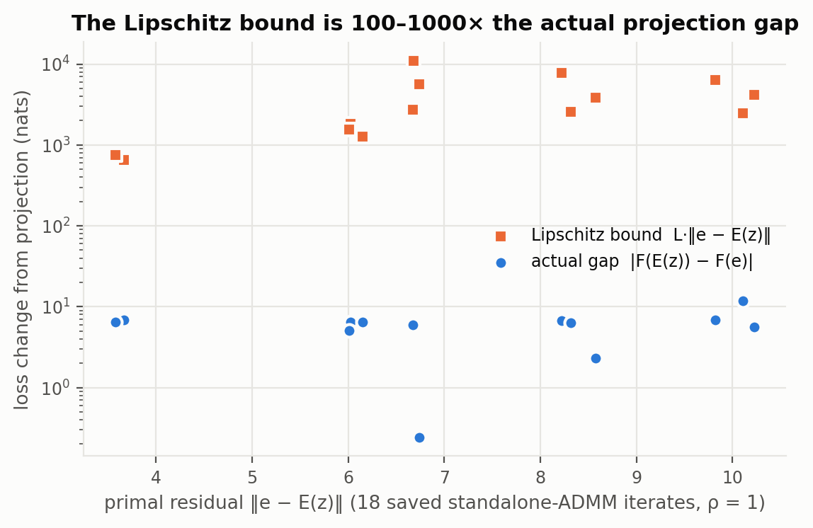
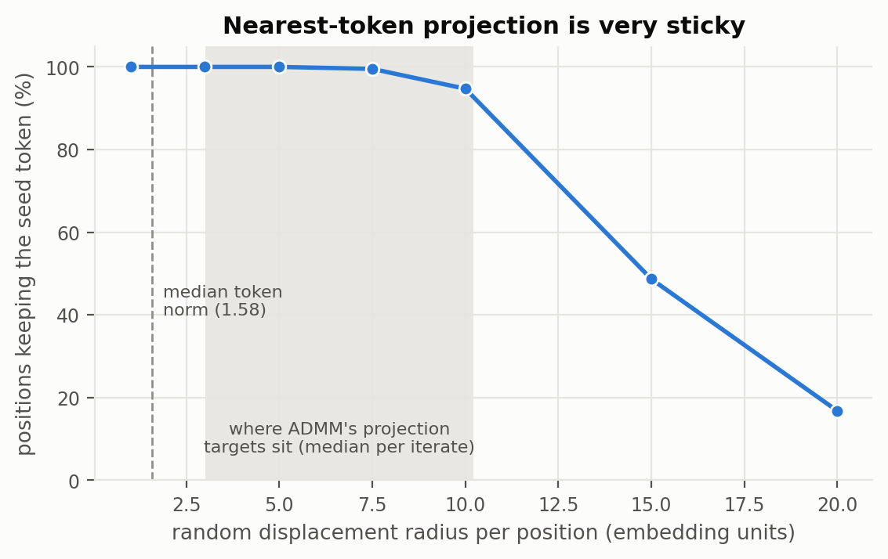
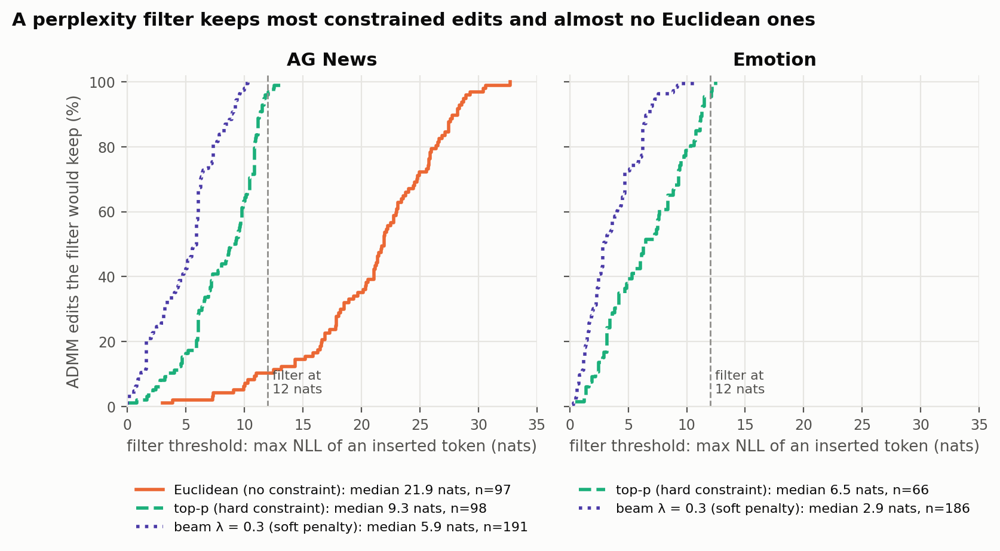
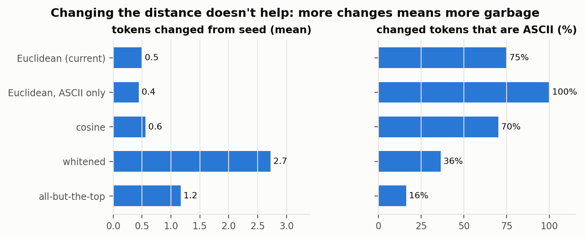
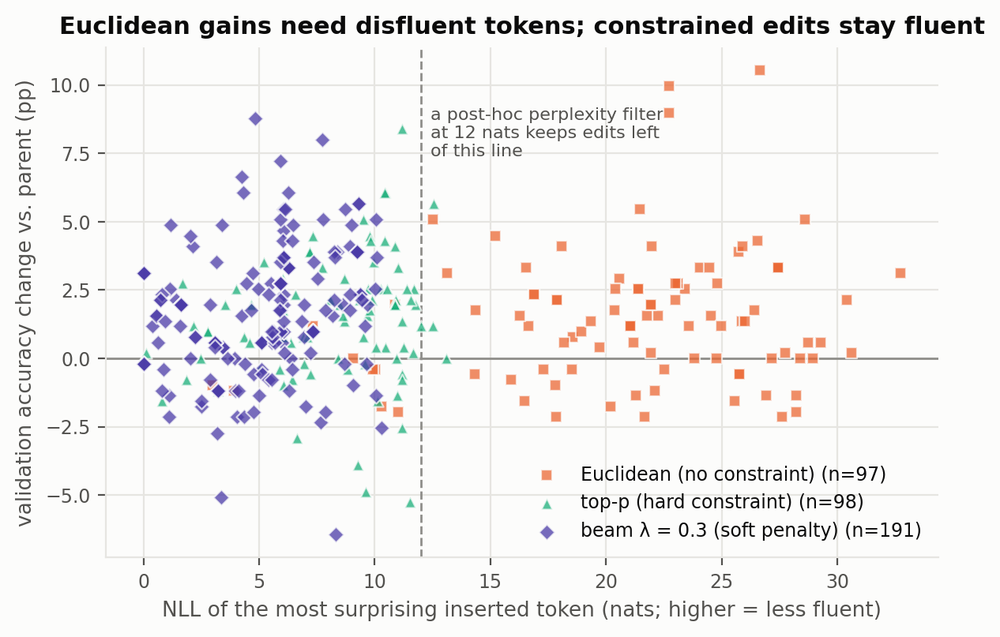
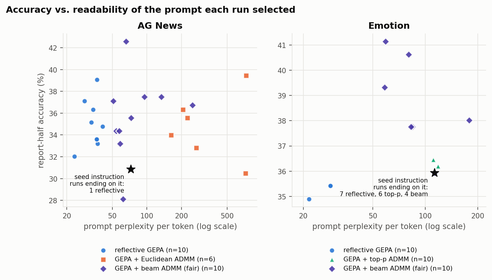

# Figures: projection diagnostics and fluency analysis

Six figures explaining what ADMM's projection step (turning continuous vectors
back into tokens) does, and what the fluency constraints (top-p, beam search)
change.

**Regenerate.** `python -m gepa_pilot.make_figures`
([`src/gepa_pilot/make_figures.py`](../../src/gepa_pilot/make_figures.py)) reads:
- [`../projection_diagnostics/report.json`](../projection_diagnostics/report.json),
  from `projection_diagnostics.py`;
- [`../fluency_analysis/{agnews,emotion}.json`](../fluency_analysis/), from
  `fluency_analysis.py`;
- [`../classification_results/summary.json`](../classification_results/summary.json),
  from `summarize_classification.py`.

**Conventions.**
- Each method keeps one color in every figure:
  - **blue**: reflective GEPA, or a single series;
  - **orange**: Euclidean ADMM proposer (no fluency constraint);
  - **aqua**: top-p ADMM proposer;
  - **violet**: beam-search ADMM proposer.
- Gray is reserved for reference lines and bands.
- Series also differ by marker shape or line style, so color is never the only
  cue.
- "ADMM proposer" means GEPA with ADMM replacing reflection; "standalone ADMM"
  means the pilot's runs outside GEPA.
- **Edit NLL** is the negative log-likelihood, under the frozen Qwen3-1.7B, of
  the most surprising token an ADMM edit inserted, in its context. Higher means
  less fluent: 2.3 nats is about a 1-in-10 token, 9 nats about 1-in-8,000,
  22 nats about 1-in-3.6 billion.
- **Perplexity per token** is exp(mean NLL of the instruction's tokens).
  - Both quantities are measured given the fixed prompt prefix. In this prompt
    the label mapping comes *after* the instruction, so task words such as
    "capital letter" are already surprising. The seed instruction itself scores
    72 (AG News) and 113 (emotion).
  - So compare these values with the seed's, rather than reading them as
    absolute fluency.

---

## Figure 1 — the Lipschitz bound says nothing useful about the projection

**What is plotted**
- 18 saved iterates from three standalone ADMM runs at ρ = 1, on AG News
  (iterations 5–30 of each).
- **x-axis:** the primal residual ‖e − E(z)‖, i.e. how far the continuous slot is
  from its projected tokens.
- **y-axis (log scale):**
  - **Squares:** the Lipschitz bound L·‖e − E(z)‖, with L the largest gradient
    norm sampled along the segment from e to E(z).
  - **Circles:** the actual loss change from projecting, F(E(z)) − F(e), as label
    cross-entropy on a fixed 32-example training batch.
- One iterate had a gap of −0.24 (projection *helped*); it's plotted at |gap|.

**How to read it.** A useful bound would sit just above its circle. Here every
square is 2–3 orders of magnitude higher.

**What it shows**
- **The bound is useless:** it predicts 654–10,996 nats of possible damage, when
  the real gap is 5–7 nats (median 6.45, max 11.9).
- **The real gap is large anyway:** about 6.5 nats, roughly the whole gain
  of the continuous optimization. The continuous slot reaches about 2 nats of
  loss, while the projected prompt usually stays at the seed's 8.75.
- **Theory can't certify ADMM's projection.** Gradients near these points are
  steep (L = 178–1,646). Only a tiny residual could keep the bound meaningful,
  and ADMM's residuals here are 3.6–10.2.

**Caveat:** the bound uses the largest of 9 gradient norms sampled along the
segment, so it is only an estimate of the true Lipschitz constant; the true
bound could be larger still.

**Used in:** [projection diagnostics §1](../projection_diagnostics/README.md),
[CLASSIFICATION_RESULTS.md §5.4](../../CLASSIFICATION_RESULTS.md).

---

## Figure 2 — nearest-token projection is very sticky

**What is plotted**
- The 25 token embeddings of the AG News seed instruction, moved in random
  directions by a fixed distance (the **radius**, x-axis), then projected back to
  the nearest allowed token. 200 random draws per radius.
- **y-axis:** the share of positions whose token *didn't* change.
- **Gray band:** where ADMM's real projection targets e + u sit relative to their
  chosen tokens (median distance per iterate, 3.0–10.2).
- **Dashed line:** the median length of a token embedding (1.58).

**How to read it.** The curve stays at 100% until the displacement is far larger
than a token itself.

**What it shows**
- **Every token has a huge region of embedding space that maps back to it:**
  - up to radius 5, about 3× a token's length, no position changes;
  - at radius 10, only 5% change;
  - only at radius 15–20 do half or more change.
- **This explains why ADMM so often returns the seed unchanged.** The
  continuous slot can travel far, and lower its loss a lot, without crossing into
  another token's region.
- **The tokens random moves *do* reach are sensible** (not shown in the plot;
  see the projection-diagnostics README):
  - case, whitespace and language variants of the original word, such as
    `output` → ` Output` / `输出` and `label` → `\tlabel`;
  - so the geometry itself isn't what produces garbage tokens (Figure 3).
- **ADMM's real targets sit inside the gray band**, where random moves would
  almost never change a token. So when ADMM does change one, it's because the
  gradient pushed in a *specific* direction.

**Caveat:** random directions in 2,048 dimensions are almost orthogonal to every
token difference, so this measures stickiness against *undirected* moves.
Gradient-directed moves cross boundaries more easily.

---

## Figure 3 — what a perplexity filter would keep

**What is plotted**
- One curve per projection, over every ADMM edit that produced a child.
  Left: AG News; right: emotion (there were no Euclidean runs on emotion).
- **x-axis:** a filter threshold in nats.
- **y-axis:** the share of edits whose edit NLL is at or below that threshold,
  i.e. the edits that a post-hoc perplexity filter at that threshold would keep.
- **Dashed line:** a 12-nat threshold, used as a reference throughout.
- **The legend gives each projection's median edit NLL:**

| Task | Projection | Fluency constraint | Median edit NLL | Edits | Kept at 12 nats |
|---|---|---|---:|---:|---:|
| AG News | Euclidean | none | 21.9 | 97 | 10.3% |
| AG News | top-p | hard, per token (99% nucleus) | 9.3 | 98 | 95.9% |
| AG News | beam, λ = 0.3 | soft NLL penalty on the whole slot | 5.9 | 191 | 100% |
| Emotion | top-p | hard, per token | 6.5 | 66 | 95.5% |
| Emotion | beam, λ = 0.3 | soft penalty | 2.9 | 186 | 100% |

**How to read it.** A curve that rises steeply on the left means the projection
mostly inserts tokens the model finds plausible. The farther right a curve
rises, the more disfluent its edits.

**What it shows**
- **Each step of fluency constraint shifts the curve left:** Euclidean (median
  21.9 nats, about 1-in-3.6-billion tokens) → top-p (9.3) → beam (5.9).
- **A post-hoc filter is catastrophic for Euclidean ADMM**, keeping 10% of its
  edits, and nearly harmless for the constrained projections.
- **Constraining fluency *during* the search** (top-p's candidate set, beam's
  penalty) achieves what a filter afterwards can't: edits that are fluent by
  construction.

**Why not filter by embedding norm instead?** The projection diagnostics
originally attributed the garbage to low-norm "glitch" tokens. But fluent top-p
and beam edits use tokens of similarly low norm (median 24th–27th percentile,
against 20th for Euclidean), so norm doesn't separate garbage from fluent edits.
NLL does. A plot of that comparison was produced and dropped for exactly this
reason.

---

## Figure 4 — changing the projection distance doesn't help

**What is plotted**
- The same 18 standalone-ADMM targets e + u as in Figure 1, projected under five
  different distances.
- **Left:** mean number of tokens changed from the seed.
- **Right:** share of the changed tokens that are plain ASCII.
- The five distances:
  - **Euclidean:** the current rule;
  - **Euclidean, ASCII only:** Euclidean restricted to ASCII tokens;
  - **cosine:** angle only, ignoring length;
  - **whitened:** Mahalanobis distance under the vocabulary's covariance;
  - **all-but-the-top:** mean and top 20 principal directions removed, then
    cosine.

**How to read it.** The goal would be *more* changes that are *also* readable.

**What it shows**
- **Euclidean and cosine barely change anything** (0.5–0.6 tokens) and are
  mostly ASCII (70–75%).
- **Whitening and all-but-the-top change more tokens** (2.7 and 1.2) but
  overwhelmingly into non-ASCII garbage (36% and 16% ASCII). They also scored
  worse (mean loss 9.73 and 9.28, against 8.77 for Euclidean).
- **Restricting to ASCII** removes foreign characters but changes nothing
  structurally (0.4 tokens).
- **Conclusion:** the problem is *where the target e + u is*, not how distance
  to tokens is measured. That motivated constraining the target's candidates
  (top-p and beam) instead of changing the metric.

---

## Figure 5 — Euclidean gains need disfluent tokens; constrained edits find fluent gains

**What is plotted**
- One point per AG News ADMM edit where both the parent and the child were
  scored on all 512 validation examples.
- **x-axis:** edit NLL.
- **y-axis:** the child's validation accuracy minus the parent's, in percentage
  points.
- **Dashed line:** the 12-nat filter; **solid line:** no change.
- **Markers:** squares = Euclidean, triangles = top-p, diamonds = beam λ = 0.3.

**How to read it.** Points above the solid line helped. Points right of the
dashed line would be removed by a perplexity filter.

**What it shows**

| Projection | Edits that helped | Helpful edits a 12-nat filter keeps | Largest gain |
|---|---:|---:|---:|
| Euclidean | 66 of 97 | **3** | +10.6 pp (` capital` → `资本`) |
| Top-p | 74 of 98 | 71 | +8.4 pp |
| Beam λ = 0.3 | 149 of 191 | 149 | +8.8 pp |

- **Every large Euclidean gain is a garbage token:** `资本`, `משכנתא`, `靺`,
  `.DropDownItems`, ` analsex`. Fluency and helpfulness are unrelated within
  Euclidean edits, so filtering them throws away the gains.
- **Top-p and beam find gains of similar size inside the fluent region.** The
  fluency constraint doesn't cost the search its ability to find helpful
  edits.
- **Many points sit near zero.** Validation accuracy on 512 examples has a
  standard error of about 2 pp, so gains under about 2–3 pp are within noise.
  The figure is about where the *large* gains sit, not about individual small
  points.

**Caveats**
- "Validation gain" here uses the full 512-example validation set, the same one
  GEPA partly selected on. So these are diagnostic numbers, not the unbiased
  report-half results.
- **Fluent is not the same as meaningful.** Top-p's +8.4 edit produced "Carefully
  determine the job's right topic…", where each token is plausible but the
  instruction got stranger. Examples:
  [`../prompt_examples/README.md`](../prompt_examples/README.md).

---

## Figure 6 — accuracy vs. readability of the prompt each run finally selected

**What is plotted**
- One point per run: the prompt that run selected, with its per-token perplexity
  (x-axis, log scale) and its accuracy on the untouched 256-example report half
  (y-axis). The star is the seed instruction.
- **AG News (left):**
  - reflective GEPA (10 runs);
  - GEPA + Euclidean ADMM proposer (the six Phase 1 held-out runs, ρ = 0.3 and 1,
    re-scored on the report half);
  - GEPA + beam ADMM proposer with fair independent acceptance (Phase 6, 10 runs).
- **Emotion (right):** reflective GEPA, the top-p ADMM proposer, and the fair
  beam ADMM proposer (10 runs each).
- **The annotation counts runs that ended exactly on the seed instruction**,
  because their points sit on top of the star. On emotion that's 7 reflective,
  6 top-p and 4 beam runs.

**How to read it.** Up is better accuracy; left is more fluent. The ideal is the
upper left.

**What it shows**

| Arm | Perplexity range | Best accuracy |
|---|---|---:|
| AG News reflective GEPA | 23–72 | 39.1% |
| AG News Euclidean ADMM proposer (held-out acceptance) | 163–733 | 39.5% |
| AG News beam ADMM proposer, fair acceptance | 51–250 | 42.6% |
| Emotion reflective GEPA | 22–113 | 35.9% |
| Emotion top-p ADMM proposer | 111–119 | 36.5% |
| Emotion beam ADMM proposer, fair acceptance | 58–179 | 41.2% |

- **Reflection writes the most fluent prompts**, more fluent than the seed
  (perplexity 23–72 against 72). Its accuracy is moderate.
- **Euclidean ADMM** reaches comparable accuracy only with prompts 2–10× less
  fluent than the seed.
- **Beam ADMM keeps prompts near the seed's fluency** (median about 65 on AG
  News) and produces the highest-accuracy prompts on both tasks.
- **On emotion, most runs barely leave the seed.** That's the "limited
  instruction leverage" finding: only beam ADMM moves several runs clearly above
  it (37.8–41.2%).
- **The AG News beam runs spread widely** (28.1–42.6%), the high seed-to-seed
  variance that makes AG News comparisons underpowered.

**Caveats**
- Perplexity is relative to this prompt layout; see the conventions above.
- Points that coincide aren't jittered, to avoid showing positions that don't
  exist; the annotation gives the counts instead.

**Used in:** [CLASSIFICATION_RESULTS.md §5.14](../../CLASSIFICATION_RESULTS.md).
